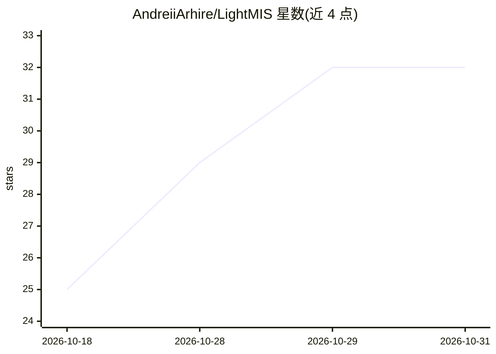

# AndreiiArhire/LightMIS

⭐ 32 · Python · 推送 2026-09-30 · [GitHub](https://github.com/AndreiiArhire/LightMIS) · [官网](https://arxiv.org/pdf/2609.28327) · 组织维护

**面向边缘设备的超轻量 2D 医学图像分割模型**

LightMIS 是一个用于 2D 二值医学图像分割的超轻量神经网络结构：以紧凑多尺度编码器配合 Adaptive Fusion Cascade（AFC）处理各尺度特征，并用 Scale-Aligned Projection（SAP）聚合头替代传统的阶段式解码器。在 nnU-Net v2.3.1 协议下于六个数据集（覆盖五个成像领域）进行五折交叉验证，相比 Mobile U-ViT、nnWNet、nnU-Net 等模型，参数量减少 90.58–99.61%，GFLOPs 减少 82.54–96.14%。在搭载 Arm Mali-G52 MC2 GPU 的智能手机上可全 GPU 委托推理，延迟 53.31–138.31 ms。使用方式依赖 nnU-Net 环境：安装配置 nnU-Net、转换数据集、放入训练器文件后用命令行五折训练，并提供预训练 checkpoint、数据集转换脚本、五折划分与基准测试脚本等可复现资源。面向科研用户。

## 筛选速览

| 维度 | 判定 | 备注 |
|---|---|---|
| AI 角色 | `ai-native` | 本体是模型或模型工具 |
| 许可风险 | `none` | — |
| 部署形态 | `None` |  |
| 模型依赖 | — | README 未给出锁定关系 |
| 硬件要求 | — | 无带数字的原话,不猜 |
| 安装摩擦 | `low` | 无编译、无系统依赖或容器化 |
| 成熟度 | — | 结构信号不足 |

## 能力要点

- AFC 多尺度融合 + SAP 聚合头替代阶段式解码器的网络结构
- 参数量较对比模型减少 90.58–99.61%，GFLOPs 减少 82.54–96.14%
- 智能手机 Arm Mali-G52 MC2 GPU 上 100% 算子全 GPU 委托，中位延迟 53.31–138.31 ms
- 提供预训练 checkpoint、数据集转换脚本、五折划分与 nnU-Net 计划文件

## 适用场景

- 在移动/边缘设备上运行 2D 医学图像分割推理
- 在六个公开医学数据集上复现五折交叉验证实验
- 作为 nnU-Net 框架中的轻量训练器进行医学分割研究

## 场景标签

`目标检测` `科研工具` · 领域:学习与行业

## 证据(README 行号)

> L8: LightMIS employs a compact multi-scale encoder in which an Adaptive Fusion Cascade (AFC) processes features at every
> L12: Evaluated under a common nnU-Net v2.3.1 protocol using five-fold cross-validation on six datasets spanning five ima
> L16: - Install and configure **nnU-Net**. The experiments in this repository use nnU-Net v2.3.1.

## 星数曲线

2026-10-18 25 → 2026-10-31 32（+7）

---
*卡片 v1 · prompt 1.4 · 生成 2026-10-27 · 置信度 high · 依据 README sha `b7dfde972b80` · [字段定义](../../DATASET.md)*
