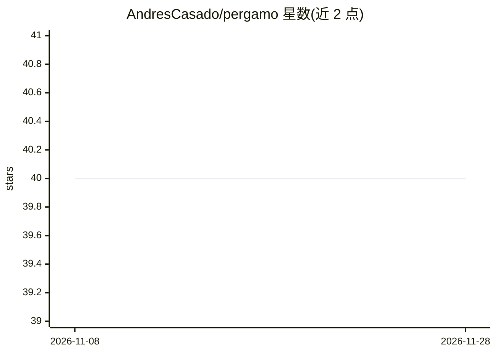

# AndresCasado/pergamo

⭐ 40 · Python · 推送 2026-11-08 · [GitHub](https://github.com/AndresCasado/pergamo) · [官网](http://mslab.es/projects/PERGAMO/) · 个人维护

**从单目视频学习3D服装可变形模型的研究代码**

PERGAMO（SCA 2022 论文）的两步方法：先从单目图像重建服装3D几何，构建服装数据集；再用回归模型根据身体姿态预测服装形变，可泛化到动作捕捉数据中未见过的动作。安装需 PyTorch、IGL、Kaolin，并从 OneDrive 下载权重、从官方渠道获取 SMPL 模型；通过 run_recons.sh 与 run_regression.sh 脚本运行，结果可用 Blender 可视化。面向科研复现者，代码含数据处理与训练/回归流程。

## 筛选速览

| 维度 | 判定 | 备注 |
|---|---|---|
| AI 角色 | `ai-native` | 本体是模型或模型工具 |
| 许可风险 | `none` | — |
| 部署形态 | `library` | 以包/库形式分发 |
| 模型依赖 | — | README 未给出锁定关系 |
| 硬件要求 | — | 无带数字的原话,不猜 |
| 安装摩擦 | `low` | 无编译、无系统依赖或容器化 |
| 成熟度 | — | 结构信号不足 |

## 能力要点

- 从单目图像重建服装3D几何并构建数据集
- 回归模型根据身体姿态预测服装形变（皱纹顶点位移）
- 提供 SoftSMPL 姿态编码生成脚本
- 支持在 AMASS 序列上运行回归并泛化到未见动作

## 适用场景

- 复现论文的单目视频服装重建与形变回归流程
- 研究数字人服装动画的替代物理仿真方法
- 用自有 SMPL 姿态序列生成服装动画

## 场景标签

`科研工具` · 领域:学习与行业

## 证据(README 行号)

> L14: > samples. To circumvent both issues we propose PERGAMO, a data-driven approach to learn a deformable model for 3D
> L17: > reconstructions to train a regression model that accurately predicts how the garment deforms as a function of the

## 星数曲线

2026-11-08 40 → 2026-11-28 40（+0）

---
*卡片 v1 · prompt 1.4 · 生成 2026-11-18 · 置信度 mid · 依据 README sha `93f916a6dfcc` · [字段定义](../../DATASET.md)*
