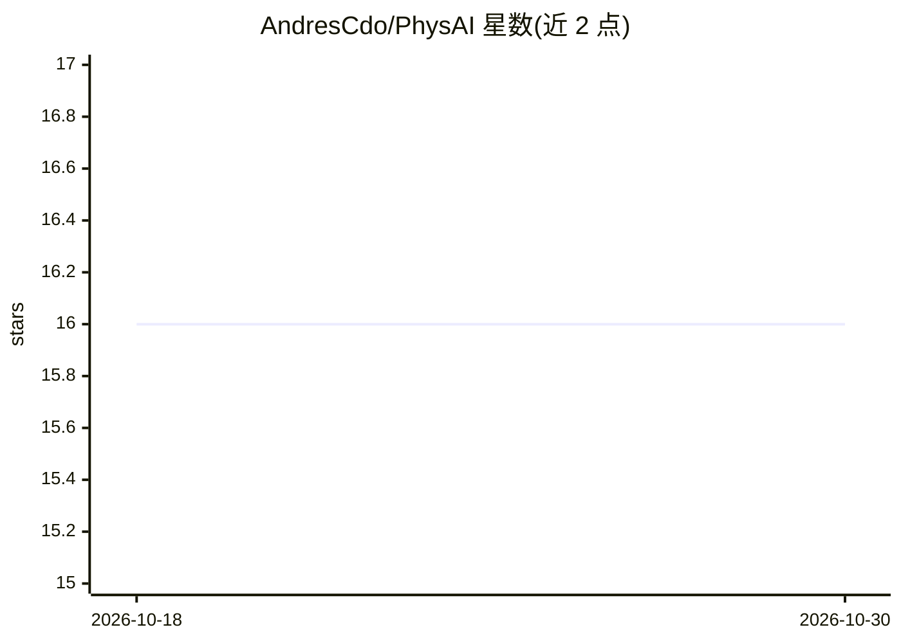

# AndresCdo/PhysAI

⭐ 16 · Python · MIT · 推送 2026-08-12 · [GitHub](https://github.com/AndresCdo/PhysAI) · 个人维护

**LLM 引导符号回归的物理方程发现研究框架**

神经符号研究项目：本地小规模 LLM（经 Ollama 运行，如 granite4:1b）生成候选方程假设，计算机代数系统（Wolfram Engine/Mathematica，需许可）负责拟合与打分，配以量纲分析、语法校验等约束层。项目自述为开发中的研究提案，未声称任何发现结果；历史运行因提示词污染作废，全部里程碑待重跑，README 还列出了验证路径的三个已知缺陷与后续对照实验议程。面向物理与 AI 交叉方向的研究者和学生。

## 筛选速览

| 维度 | 判定 | 备注 |
|---|---|---|
| AI 角色 | `ai-native` | 本体是模型或模型工具 |
| 许可风险 | `permissive` | MIT |
| 部署形态 | `library` | 以包/库形式分发 |
| 模型依赖 | local-ok | 支持本地模型 |
| 硬件要求 | — | 无带数字的原话,不猜 |
| 安装摩擦 | `low` | 无编译、无系统依赖或容器化 |
| 成熟度 | `idea` | |

## 能力要点

- LLM 生成假设 + 符号引擎拟合打分的双阶段架构
- 量纲分析在拟合前做单位一致性剪枝
- 本地 Ollama 推理，无需外部 API
- 已建立提示词去污染测试并公开五个待重跑里程碑

## 适用场景

- 从噪声实验数据中探索经验物理关系
- 研究小模型对符号回归是否贡献物理先验
- 作为神经符号物理发现方向的教学与复现项目

## 场景标签

`科研工具` · 领域:学习与行业

## 证据(README 行号)

> L3: **Neuro-Symbolic Framework for Physics Equation Discovery via LLM-Guided Program Synthesis**
> L125: **"Can a small, local Large Language Model effectively guide a symbolic computation engine to discover physical la
> L127: This project explores the hypothesis that neuro-symbolic AI can automate symbolic regression for physics discovery

## 星数曲线

2026-10-18 16 → 2026-10-30 16（+0）

---
*卡片 v1 · prompt 1.4 · 生成 2026-10-30 · 置信度 mid · 依据 README sha `9d5d336ee7df` · [字段定义](../../DATASET.md)*
