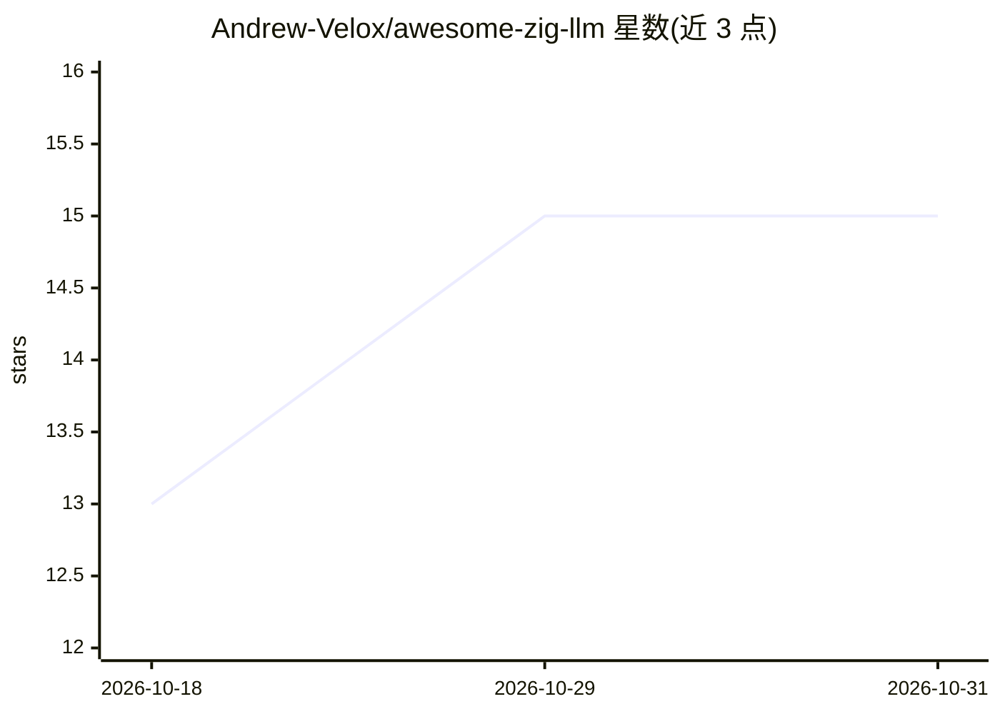

# Andrew-Velox/awesome-zig-llm

⭐ 15 · 推送 2026-09-25 · [GitHub](https://github.com/Andrew-Velox/awesome-zig-llm) · 个人维护

**Zig 语言的 LLM/机器学习生态项目策展清单**

一个 awesome 类策展清单，收录以 Zig 编程语言实现的 LLM 推理引擎、训练/自动微分框架、C/C++ ML 库绑定（llama.cpp、ONNX Runtime、MLX、Ollama 客户端等）、张量与线性代数库、分词器、终端工具与学习资源。条目按类别组织并标注星数，附简介，接受社区贡献。面向寻找 Zig 生态 AI 工具的开发者与关注底层实现的学习者。

## 筛选速览

| 维度 | 判定 | 备注 |
|---|---|---|
| AI 角色 | `ai-knowledge` | 知识聚合/清单类 |
| 许可风险 | `none` | — |
| 部署形态 | `None` |  |
| 模型依赖 | — | README 未给出锁定关系 |
| 硬件要求 | — | 无带数字的原话,不猜 |
| 安装摩擦 | `medium` | 含编译或系统依赖之一 |
| 成熟度 | — | 结构信号不足 |

## 能力要点

- 覆盖推理引擎、训练框架、绑定、张量库、分词器、工具应用与学习资源 7+ 个类别
- 收录 llama.cpp/ONNX Runtime/MLX/Ollama 的 Zig 绑定与客户端项目
- 条目附星数与一句简介，开放社区贡献

## 适用场景

- 查找 Zig 实现的 LLM 推理引擎或张量库
- 寻找 llama.cpp、MLX 等框架的 Zig 绑定
- 学习用 Zig 从零实现神经网络与推理的参考项目

## 场景标签

`精选清单` · 领域:学习与行业

## 证据(README 行号)

> L1: # Awesome Zig LLM Awesome
> L3: > A curated list of awesome Large Language Model (LLM), Machine Learning, and AI projects, libraries, and resources 
> L5: Zig's performance, explicit memory management, and seamless C/C++ interoperability make it an exceptionally powerful

## 星数曲线

2026-10-18 13 → 2026-10-31 15（+2）

---
*卡片 v1 · prompt 1.4 · 生成 2026-10-31 · 置信度 high · 依据 README sha `bcbdb29c77d5` · [字段定义](../../DATASET.md)*
