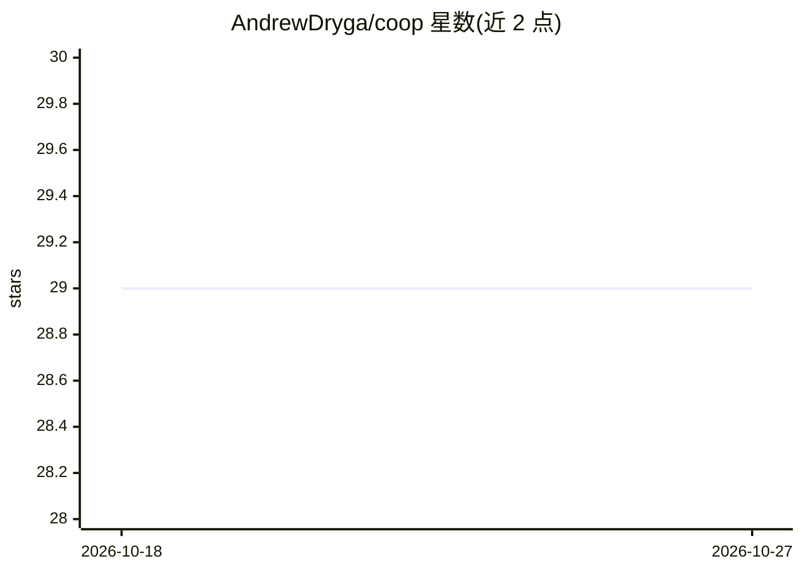

# AndrewDryga/coop

⭐ 29 · Go · MIT · 推送 2026-10-26 · [GitHub](https://github.com/AndrewDryga/coop) · [官网](http://coop.dryga.com/) · 个人维护

**面向开发者的编码 agent 沙箱运行器：隔离权限、任务队列与无人值守循环**

co:op 是一个 Go 编写的 CLI 工具，将 Claude Code、Codex、Gemini CLI、Grok 等编码 agent 放入容器沙箱运行：沙箱仅挂载当前项目目录，SSH 密钥、云登录凭据与 .env 秘密保留在宿主机，配合过滤网络限制出站域名。提供任务队列（coop loop，每任务新起 agent）、fork 工作流、多账号/模型轮换、预设模型团队、MCP 服务器管理、编辑器（Zed/ACP）接入与评测（分离验证者打分）等功能。安装脚本下载静态二进制，macOS/Linux 需 Docker。面向让 agent 无人值守过夜工作的开发者。

## 筛选速览

| 维度 | 判定 | 备注 |
|---|---|---|
| AI 角色 | `ai-ecosystem` | LLM/agent 周边工具 |
| 许可风险 | `permissive` | MIT |
| 部署形态 | `self-host` | docker 或自建部署 |
| 模型依赖 | locked-api |  |
| 硬件要求 | — | 无带数字的原话,不猜 |
| 安装摩擦 | `low` | 无编译、无系统依赖或容器化 |
| 成熟度 | — | 结构信号不足 |

## 能力要点

- 容器沙箱仅挂载项目目录，凭据与秘密留在宿主机（沙箱内 .env 为空文件）
- 任务队列 + coop loop 无人值守循环，每任务新起 agent，未完成工作进入终审
- 同一沙箱运行 Claude Code、Codex、Gemini CLI、Grok，支持多账号/模型/预设团队轮换
- 过滤网络仅放行 AI provider 与批准域名；评测由独立验证者打分

## 适用场景

- 关闭权限确认让编码 agent 无人值守跑任务队列过夜
- 防止 agent 因提示注入或误操作泄露 SSH 密钥、.env 或破坏宿主文件
- 在隔离环境中并行运行多个 agent 并轮换账号额度
- 从 Zed/ACP 编辑器操控沙箱内的 agent 并复用 MCP 服务器配置

## 场景标签

`编码 Agent` · 领域:编码与开发

## 证据(README 行号)

> L14: co:op runs the agent in a container that sees one folder: your project, at its real path. Your SSH
> L15: keys, cloud logins and other repos aren't in it. The same box runs Claude Code, Codex, Gemini CLI
> L136: `coop loop` works through the queue on its own, with a fresh agent for every task. A final review

## 星数曲线

2026-10-18 29 → 2026-10-27 29（+0）

---
*卡片 v1 · prompt 1.4 · 生成 2026-10-26 · 置信度 mid · 依据 README sha `25927cd0d5c2` · [字段定义](../../DATASET.md)*
