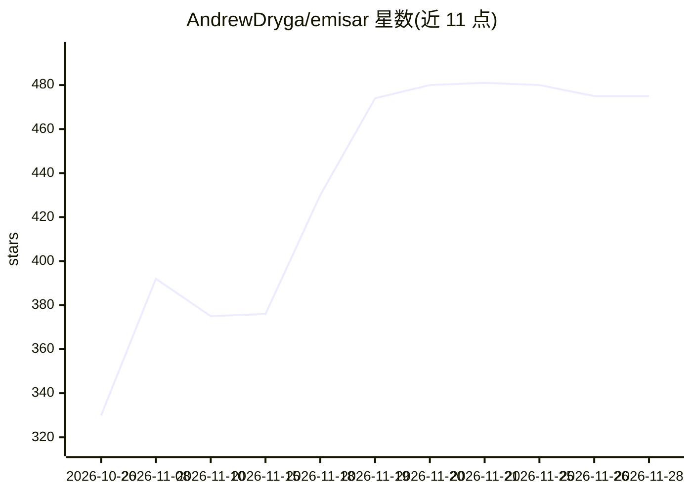

# AndrewDryga/emisar

⭐ 475 · Elixir · NOASSERTION · 推送 2026-11-27 · [GitHub](https://github.com/AndrewDryga/emisar) · [官网](https://emisar.dev/) · 个人维护

**给 AI agent 提供受策略约束的基础设施操作通道**

emisar 让 AI agent 通过 CLI 或 MCP 访问基础设施：操作者声明可用的动作包（定义可执行文件、参数 schema、风险等级、超时、输出脱敏等），策略决定自动执行、需审批或拒绝。每台主机上的 runner 以出站 TLS WebSocket 连接控制面，执行前校验动作与参数，输出脱敏后留存，审计日志含拒绝与待审请求，runner 本地写哈希链 JSONL 日志。控制面为 Elixir/Phoenix，runner 为 Go，另提供 stdio MCP 桥接。

## 筛选速览

| 维度 | 判定 | 备注 |
|---|---|---|
| AI 角色 | `ai-ecosystem` | LLM/agent 周边工具 |
| 许可风险 | `none` | NOASSERTION |
| 部署形态 | `None` |  |
| 模型依赖 | — | README 未给出锁定关系 |
| 硬件要求 | — | 无带数字的原话,不猜 |
| 安装摩擦 | `low` | 无编译、无系统依赖或容器化 |
| 成熟度 | — | 结构信号不足 |

## 能力要点

- 动作包声明式定义执行边界，模型只能选择而非构造命令行
- runner 出站连接、校验包哈希、按声明限制执行并脱敏输出
- 控制面策略评估含条件审批与常设授权，审计覆盖拒绝与待审请求
- 可选 bridge 签名（Ed25519/ECDSA P-256）防止控制面扩大许可调用

## 适用场景

- 让 AI agent 在生产主机上执行运维动作而不授予完整 shell
- 为 agent 操作设置自动执行/审批/拒绝的策略边界
- 集中管理多主机的 agent 可用动作目录

## 场景标签

`网络安全` · 领域:学习与行业

## 证据(README 行号)

> L5: emisar gives AI agents remote access to infrastructure through CLI or MCP.
> L118: |Connect Claude, ChatGPT, Cursor, Codex, or another MCP client|Connect a CLI agent|

## 星数曲线

2026-10-26 330 → 2026-11-28 475（+145）

---
*卡片 v1 · prompt 1.4 · 生成 2026-11-25 · 置信度 high · 依据 README sha `9d6db9bda365` · [字段定义](../../DATASET.md)*
