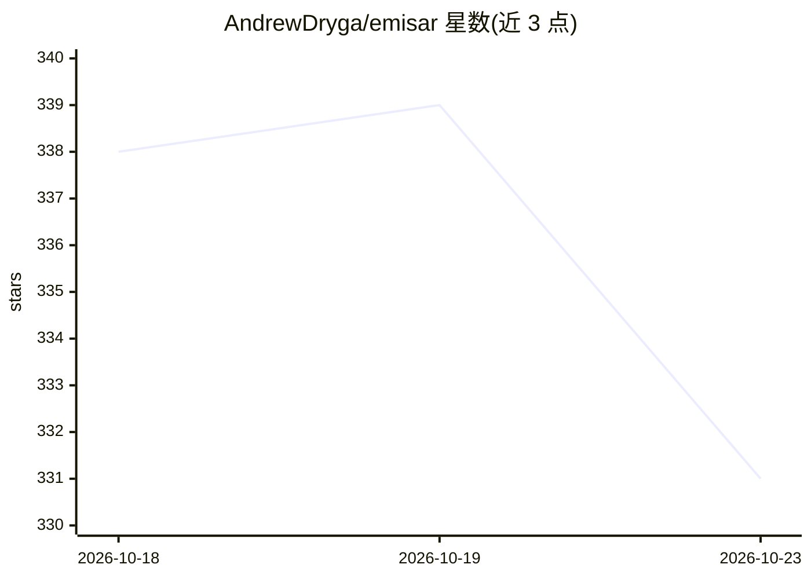

# AndrewDryga/emisar

⭐ 331 · Elixir · NOASSERTION · 推送 2026-10-22 · [GitHub](https://github.com/AndrewDryga/emisar) · [官网](https://emisar.dev/) · 组织维护

**让 AI agent 经策略约束以声明式动作操作基础设施的 MCP 平台**

emisar 向 MCP 客户端的 AI agent 提供声明式基础设施动作目录而非 shell：动作由 pack 定义（可执行文件、参数 schema、风险、超时、脱敏等），控制平面按 runner 范围、风险策略、条件审批决定放行/等人/拒绝，主机端 outbound-only runner 在执行前二次校验并写哈希链审计日志。面向运维与安全团队，需 emisar 账号与 Linux 主机（systemd、sudo），由 Elixir/Phoenix 控制平面与 Go runner/桥组成；明确声明自身不是沙箱、不替代 SSH 与最小权限管理。

## 筛选速览

| 维度 | 判定 | 备注 |
|---|---|---|
| AI 角色 | `ai-ecosystem` | LLM/agent 周边工具 |
| 许可风险 | `none` | NOASSERTION |
| 部署形态 | `None` |  |
| 模型依赖 | — | README 未给出锁定关系 |
| 硬件要求 | — | 无带数字的原话,不猜 |
| 安装摩擦 | `low` | 无编译、无系统依赖或容器化 |
| 成熟度 | — | 结构信号不足 |

## 能力要点

- 声明式动作目录 + 策略与人工审批，runner 在主机端二次校验
- 内容寻址的 pack 信任与输出脱敏，含哈希链审计日志
- 单 MCP 接口下扩展动作包，无需为客户端增配 MCP server
- 可选桥签名 dispatch（Ed25519/ECDSA P-256）限制控制平面

## 适用场景

- 让 AI agent 在生产主机上执行受策略约束的运维动作
- 为 MCP 客户端（Claude/Cursor 等）接入统一的受控基础设施操作面
- 保留拒绝与待审批请求的完整审计轨迹以满足合规需求

## 场景标签

`Agent 框架` · 领域:Agent 开发

## 证据(README 行号)

> L5: emisar gives MCP-capable agents a catalog of declared infrastructure actions
> L127: portal/   Elixir/Phoenix control plane, operator console, website, and MCP API
> L129: mcp/      Go stdio-to-HTTP MCP bridge

## 星数曲线

2026-10-18 338 → 2026-10-23 331（-7）

---
*卡片 v1 · prompt 1.4 · 生成 2026-10-21 · 置信度 high · 依据 README sha `cd9af1d37e55` · [字段定义](../../DATASET.md)*
