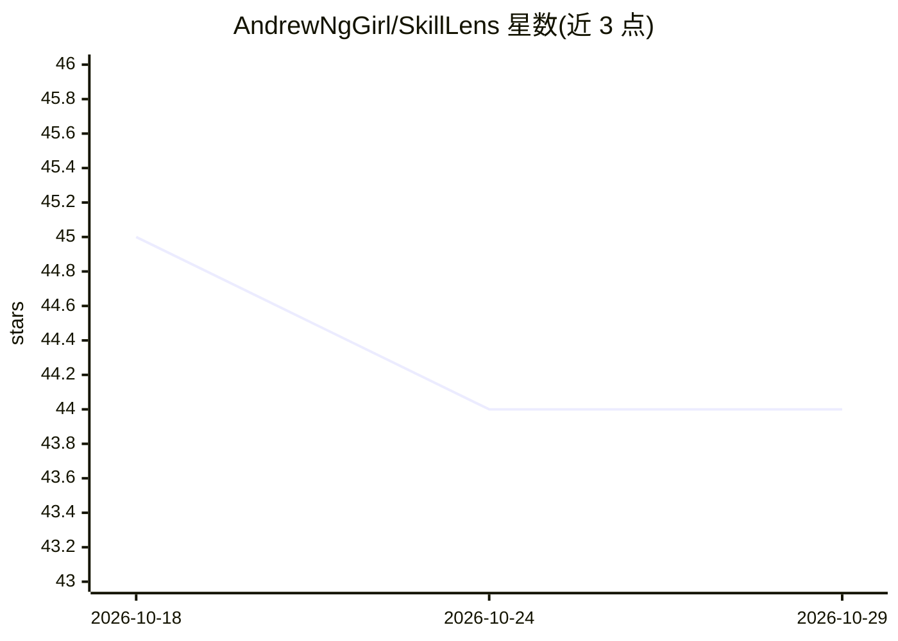

# AndrewNgGirl/SkillLens

⭐ 44 · TypeScript · MIT · 推送 2026-05-17 · [GitHub](https://github.com/AndrewNgGirl/SkillLens) · [官网](https://github.com/AndrewNgGirl/SkillLens#readme) · 个人维护 · 中文 README

**自托管 Web 工具：对 Agent Skills 做 rubric 量化评测与深度评审**

用于评测 Agent Skills（Claude/OpenClaw/Cursor 生态的 SKILL.md 包）的自托管 Web 工具与 Python CLI。上传 SKILL.md、skill 目录或 zip 包后，按 5 大支柱、34 个子维度、100 分制生成量化报告：规则分预览为确定性检查、不耗 LLM 额度；Deep Review 由 LLM 评估主观维度（需配置 DeepSeek 或 Anthropic key），规则项仍由官方 scorer 决定。支持 atomic/pipeline/composite 三种 skill 结构差异化评分，可选金融专家版附加评分。面向构建和发布 agent skill 的开发者。

## 筛选速览

| 维度 | 判定 | 备注 |
|---|---|---|
| AI 角色 | `ai-ecosystem` | LLM/agent 周边工具 |
| 许可风险 | `permissive` | MIT |
| 部署形态 | `library` | 以包/库形式分发 |
| 模型依赖 | locked-api |  |
| 硬件要求 | — | 无带数字的原话,不猜 |
| 安装摩擦 | `low` | 无编译、无系统依赖或容器化 |
| 成熟度 | — | 结构信号不足 |

## 能力要点

- 5 大支柱、100 分制 rubric，34 个子维度按 skill 结构自动启停
- 规则分预览无需 LLM key、秒级确定性返回；Deep Review 可用 LLM 评主观维度
- atomic / pipeline / composite 三种包形态自动识别与差异化评分
- Web UI 与 Agent CLI 双入口，CLI 含 deepReviewCertificate 证书校验

## 适用场景

- 开源发布或提交 marketplace 前自检 skill 质量
- 团队内部用统一 rubric 一致地比较不同 skill
- code agent 通过 CLI 自行完成 agent-side 深度评审

## 场景标签

`模型评测` · 领域:评测与运维

## 证据(README 行号)

> L9: SkillLens 是一个开源、自托管的 Web 工具，用来评测 **Agent Skills**。你可以上传一个 `SKILL.md`、一个 skill 文件夹，或一个 skill 压缩包，SkillLens 会生成量化报告，包括
> L11: 它面向正在为 Cursor、Claude、OpenClaw 或类似 Agent 生态构建 skill 的开发者，帮助你回答一个核心问题：
> L24:  - **规则分预览**：确定性检查（pass / partial / fail / not_applicable），秒级返回，不耗 LLM 额度

## 星数曲线

2026-10-18 45 → 2026-10-29 44（-1）

---
*卡片 v1 · prompt 1.4 · 生成 2026-10-25 · 置信度 high · 依据 README sha `bd7648d908f6` · [字段定义](../../DATASET.md)*
