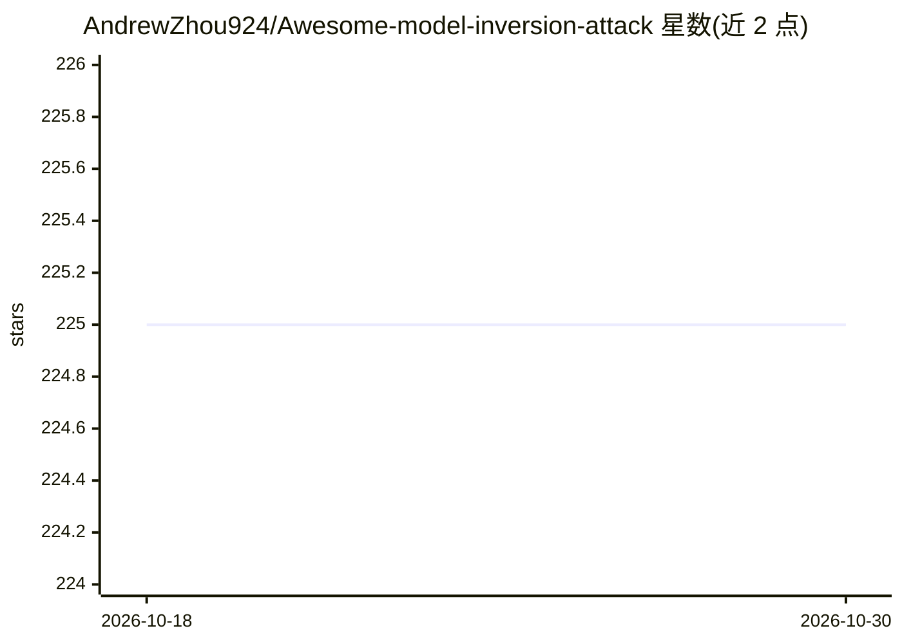

# AndrewZhou924/Awesome-model-inversion-attack

⭐ 225 · 推送 2026-08-25 · [GitHub](https://github.com/AndrewZhou924/Awesome-model-inversion-attack) · [官网](https://arxiv.org/pdf/2411.10023) · 个人维护

**模型反演攻击研究的跨领域论文策展清单（附综述）**

围绕 arXiv:2411.10023 综述《Model Inversion Attacks: A Survey of Approaches and Countermeasures》构建的论文清单：收录图像、文本、图数据上的模型反演攻击（MIA）、防御、评测与相邻数据重建问题研究，覆盖基础模型/VLM、扩散先验、协同/分割推理等方向。条目按威胁模型标注访问方式（白盒/黑盒/仅标签等）、先验资源、目标与同行评审状态，并将梯度反演、联邦学习重建等列为相邻重建问题单独归类。面向 AI 安全与隐私方向的研究者，接受社区 PR 补充。

## 筛选速览

| 维度 | 判定 | 备注 |
|---|---|---|
| AI 角色 | `ai-knowledge` | 知识聚合/清单类 |
| 许可风险 | `none` | — |
| 部署形态 | `None` |  |
| 模型依赖 | — | README 未给出锁定关系 |
| 硬件要求 | — | 无带数字的原话,不猜 |
| 安装摩擦 | `low` | 无编译、无系统依赖或容器化 |
| 成熟度 | — | 结构信号不足 |

## 能力要点

- 配套自维护的跨领域 MIA 综述（图像/文本/图数据）
- 条目按威胁模型四要素（访问/先验/目标/状态）结构化标注
- 覆盖基础模型与 VLM、扩散先验、协同/分割推理等 2024–2026 新工作
- 区分训练后 MIA 与梯度反演、训练数据提取等相邻重建问题

## 适用场景

- 查找模型反演攻击与防御方向的论文与综述
- 按访问方式与先验假设筛选符合特定威胁模型的攻击方法
- 了解基础模型/VLM 场景下的隐私泄露研究进展

## 场景标签

`精选清单` · 领域:学习与行业

## 证据(README 行号)

> L8: A curated, cross-domain collection of research on **model inversion attacks (MIAs)**, defenses, evaluation, and clos
> L13: > ### Our survey: Model Inversion Attacks: A Survey of Approaches and Countermeasures

## 星数曲线

2026-10-18 225 → 2026-10-30 225（+0）

---
*卡片 v1 · prompt 1.4 · 生成 2026-10-22 · 置信度 high · 依据 README sha `b897531cf2ab` · [字段定义](../../DATASET.md)*
