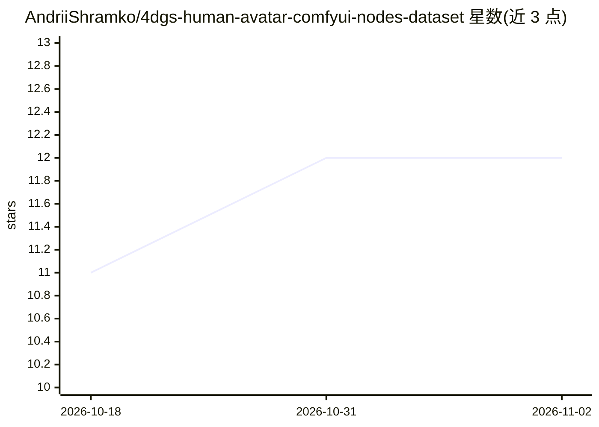

# AndriiShramko/4dgs-human-avatar-comfyui-nodes-dataset

⭐ 12 · Python · Apache-2.0 · 推送 2026-10-17 · [GitHub](https://github.com/AndriiShramko/4dgs-human-avatar-comfyui-nodes-dataset) · [官网](https://comfyui-4dgs-volumetric-node.eu/) · 个人维护

**尚未发布的 ComfyUI 4DGS 人体体积视频节点与扫描数据集仓库**

发布前的占位仓库：计划提供 Shramko-Volumetric-Bridge ComfyUI 节点（Ingest/Processing/Visualization/Export，从多相机捕获生成真实表演的 4D 高斯溅射体积视频），以及免费（CC BY-NC-4.0，托管于 Hugging Face）与企业级商用许可的人体扫描数据集。当前无可下载构建或数据，仅含 Research-docs 研究文档（含 AI 辅助生成声明）。性能指标均为目标值而非交付结果，通过落地页候补名单提供早期访问。

## 筛选速览

| 维度 | 判定 | 备注 |
|---|---|---|
| AI 角色 | `ai-ecosystem` | LLM/agent 周边工具 |
| 许可风险 | `permissive` | Apache-2.0 |
| 部署形态 | `None` |  |
| 模型依赖 | — | README 未给出锁定关系 |
| 硬件要求 | — | 无带数字的原话,不猜 |
| 安装摩擦 | `low` | 无编译、无系统依赖或容器化 |
| 成熟度 | `idea` | |

## 能力要点

- 规划中的 ComfyUI 节点覆盖 4DGS 采集、处理、可视化与导出全流程
- 规划免费（CC BY-NC-4.0）与企业级商用许可两套人体扫描数据集
- 基于 Apache-2.0 组件（gsplat、Wan 2.1）的许可合规策略
- Research-docs/v7 文档含逐条声明的验证标签

## 适用场景

- 我想在 ComfyUI 中从多相机素材生成真实表演的 4DGS 体积视频
- 我在寻找可用于商用的合规人体扫描数据集
- 我想追踪该 4DGS 模块的发布进展并加入候补名单

## 场景标签

`图像生成` · 领域:内容生成

## 证据(README 行号)

> L17: This repo will host **ComfyUI nodes** (Shramko-Volumetric-Bridge) and **human scan datasets** for 4D Gaussian Splat
> L48: - **ComfyUI nodes** — Shramko-Volumetric-Bridge: Ingest, Processing, Visualization, Export. 4DGS creation as intuit
> L49: - **Free dataset** — Human scan data for **non-commercial** use and research (CC BY-NC-4.0), hosted on Hugging Face

## 星数曲线

2026-10-18 11 → 2026-11-02 12（+1）

---
*卡片 v1 · prompt 1.4 · 生成 2026-11-01 · 置信度 mid · 依据 README sha `c1ee09710000` · [字段定义](../../DATASET.md)*
