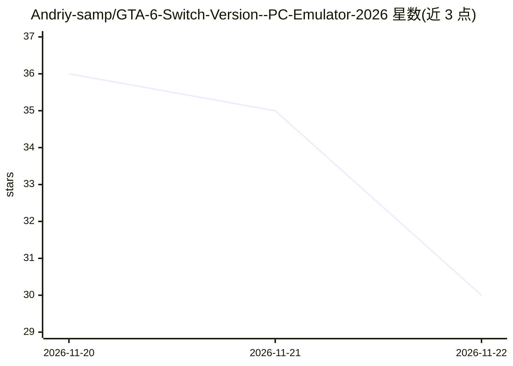

# Andriy-samp/GTA-6-Switch-Version--PC-Emulator-2026

⭐ 30 · Rust · Apache-2.0 · 推送 2026-11-21 · [GitHub](https://github.com/Andriy-samp/GTA-6-Switch-Version--PC-Emulator-2026) · 个人维护

**面向 Windows 玩家的 GTA VI PC 版安装准备指南与配套工具页**

该仓库自称是 GTA VI PC 版的安装与配置资源，内容为 Windows 环境准备步骤（系统更新、GPU 驱动、存储检查、Rockstar Games Launcher 配置）、常见性能问题排查条目与 FAQ。其配套安装程序声明不包含 GTA VI 游戏文件，游戏需另行通过授权渠道获取；官方 PC 版发布日期与系统要求在文中标注为尚未公布，多处以“待官方信息发布后更新”表述。README 中未出现任何 AI 功能描述，主题标签中的 ai/generative-ai 在正文无对应内容。

## 筛选速览

| 维度 | 判定 | 备注 |
|---|---|---|
| AI 角色 | `ai-knowledge` | 知识聚合/清单类 |
| 许可风险 | `permissive` | Apache-2.0 |
| 部署形态 | `desktop` | 安装包/桌面程序 |
| 模型依赖 | — | README 未给出锁定关系 |
| 硬件要求 | — | 无带数字的原话,不猜 |
| 安装摩擦 | `low` | 无编译、无系统依赖或容器化 |
| 成熟度 | — | 结构信号不足 |

## 能力要点

- Windows 准备步骤清单：系统更新、驱动验证、存储与兼容性检查
- 图形设置与 FPS 排查条目（分辨率、阴影、帧时间、过热等）
- 明确声明配套安装程序不含游戏文件，需授权渠道购买

## 适用场景

- 为将来发售的 GTA VI PC 版提前准备 Windows 环境
- 按清单排查 PC 游戏的常见性能与安装问题

## 场景标签

 · 领域:游戏/桌面工具

## 证据(README 行号)

> L3: ### GTA 6 PC Installation, Setup & Performance Guide
> L5: A dedicated PC installation and configuration resource for Grand Theft Auto VI, covering Windows preparation, graphi
> L17: This repository is dedicated to Windows users preparing for the future PC edition of GTA VI.

## 星数曲线

2026-11-20 36 → 2026-11-22 30（-6）

---
*卡片 v1 · prompt 1.4 · 生成 2026-11-22 · 置信度 low · 依据 README sha `2fe487426686` · [字段定义](../../DATASET.md)*
