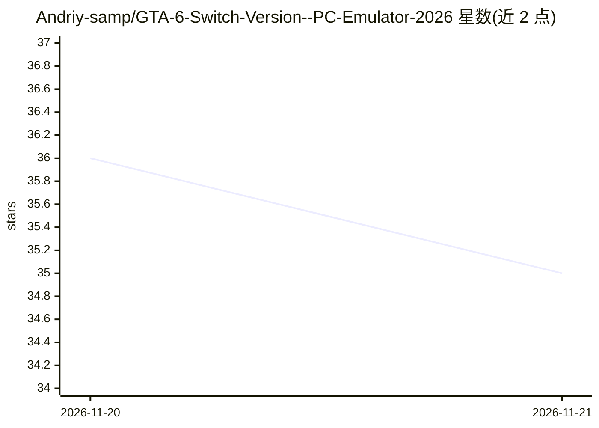

# Andriy-samp/GTA-6-Switch-Version--PC-Emulator-2026

⭐ 35 · Rust · Apache-2.0 · 推送 2026-11-19 · [GitHub](https://github.com/Andriy-samp/GTA-6-Switch-Version--PC-Emulator-2026) · 个人维护

**面向 Windows 玩家的 GTA VI PC 安装准备与优化指南站点**

该仓库定位为 GTA VI PC 版的安装与配置资源：提供 Windows 环境准备、显卡驱动更新指引、存储与兼容性检查、图形设置说明、FPS 排障清单及常见安装错误处理，并附带一个不含游戏文件的 Windows 伴生安装程序（.exe）。README 明确 GTA VI PC 版尚未公布发布日期与官方配置，各项系统要求均标注为未确认。内容以文档和指南为主，含 SEO 关键词章节。

## 筛选速览

| 维度 | 判定 | 备注 |
|---|---|---|
| AI 角色 | `ai-knowledge` | 知识聚合/清单类 |
| 许可风险 | `permissive` | Apache-2.0 |
| 部署形态 | `desktop` | 安装包/桌面程序 |
| 模型依赖 | — | README 未给出锁定关系 |
| 硬件要求 | — | 无带数字的原话,不猜 |
| 安装摩擦 | `low` | 无编译、无系统依赖或容器化 |
| 成熟度 | `idea` | |

## 能力要点

- Windows 兼容性准备清单（DirectX/驱动/存储检查）
- FPS 与卡顿问题的排障步骤列表
- 声明安装程序不包含或不安装 GTA VI 游戏文件
- 提供 NVIDIA/AMD/Intel 官方驱动下载链接

## 适用场景

- 为将来运行 GTA VI PC 版提前检查与准备 Windows 环境
- 排查 PC 游戏中的低 FPS、卡顿与显示问题
- 查阅 Rockstar 官方资源入口

## 场景标签

 · 领域:游戏/桌面工具

## 证据(README 行号)

> L3: ### GTA 6 PC Installation, Setup & Performance Guide
> L5: A dedicated PC installation and configuration resource for Grand Theft Auto VI, covering Windows preparation, graphi

## 星数曲线

2026-11-20 36 → 2026-11-21 35（-1）

---
*卡片 v1 · prompt 1.4 · 生成 2026-11-20 · 置信度 high · 依据 README sha `6954d37a13d3` · [字段定义](../../DATASET.md)*
