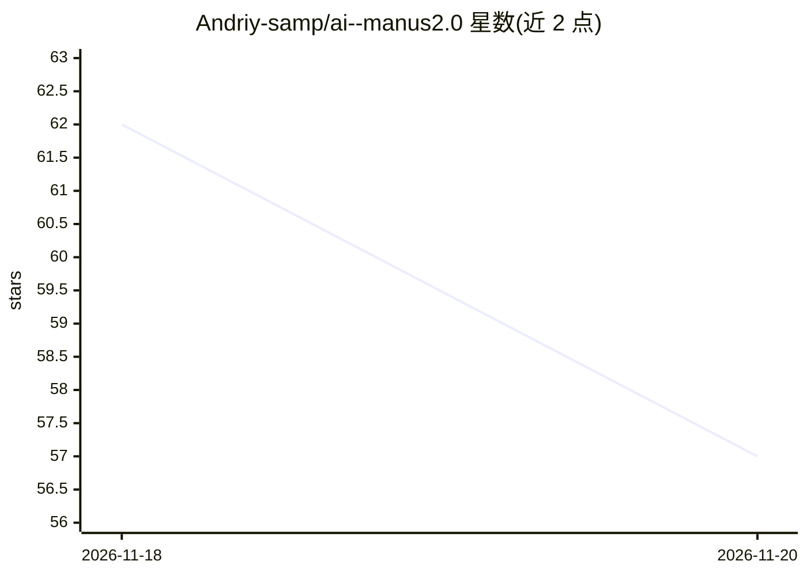

# Andriy-samp/ai--manus2.0

⭐ 57 · Apache-2.0 · 推送 2026-11-19 · [GitHub](https://github.com/Andriy-samp/ai--manus2.0) · 个人维护

**自主 AI Agent 系统：代用户运行代码与控制浏览器完成任务**

README 将其描述为一个自主 AI Agent：可自行编写并执行脚本、控制浏览器导航网页/填写表单/采集信息，把多步指令拆解为自动完成的任务，定位于家庭、学习与轻度办公场景的小型任务自动化。内容未给出安装命令、源码结构或 API 配置说明，仅有下载入口与最低配置表（64 位系统、双核 CPU、4GB 内存）。主题标签含 openai、anthropic、function-calling、multimodal，但正文未展开技术实现细节。

## 筛选速览

| 维度 | 判定 | 备注 |
|---|---|---|
| AI 角色 | `ai-native` | 本体是模型或模型工具 |
| 许可风险 | `permissive` | Apache-2.0 |
| 部署形态 | `None` |  |
| 模型依赖 | — | README 未给出锁定关系 |
| 硬件要求 | — | 无带数字的原话,不猜 |
| 安装摩擦 | `low` | 无编译、无系统依赖或容器化 |
| 成熟度 | — | 结构信号不足 |

## 能力要点

- 自主代码执行：Agent 自行运行脚本完成任务
- 浏览器控制：导航网页、填写表单、采集信息
- 后台个人助理模式，跨会话保持任务模式
- 提供系统最低配置要求（4GB 内存起步）

## 适用场景

- 让学生整理研究资料并运行小段脚本计算
- 远程办公时从多个网页自动采集数据
- 把重复的表单填写与文件整理交给 Agent 处理

## 场景标签

`AI 助手` `浏览器自动化` · 领域:效率与自动化

## 证据(README 行号)

> L18: Manus is an autonomous AI agent designed to run code and control a browser on your behalf. Instead of acting like a
> L22: Manus is not a heavy studio suite or a complex enterprise platform. It is a focused helper built for home, study, a
> L41: |**Memory (RAM)**|4 GB|8 GB or more for heavy Manus autonomous tasks|

## 星数曲线

2026-11-18 62 → 2026-11-20 57（-5）

---
*卡片 v1 · prompt 1.4 · 生成 2026-11-20 · 置信度 mid · 依据 README sha `202c1bf76f25` · [字段定义](../../DATASET.md)*
