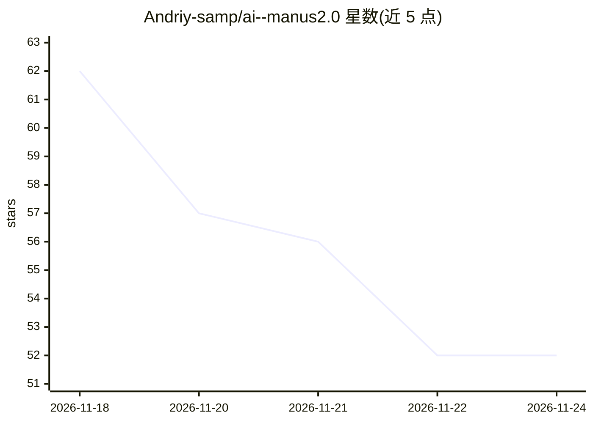

# Andriy-samp/ai--manus2.0

⭐ 40 · Apache-2.0 · 推送 2026-11-21 · [GitHub](https://github.com/Andriy-samp/ai--manus2.0) · 个人维护

**面向个人用户的自主 AI Agent：代为执行代码与浏览器操作**

README 将 Manus 描述为一个自主 AI Agent：可自行编写并执行脚本、控制浏览器（打开网页、填写表单、采集信息）、执行多步任务，定位为面向家庭、学习与轻量办公场景的个人助手，声称跨会话记住工作模式。以桌面下载方式提供，附最低系统要求（64 位系统、双核 CPU、4 GB 内存）。README 为营销式介绍，未给出安装命令、源码或技术架构细节，接入哪些模型亦未在正文说明。

## 筛选速览

| 维度 | 判定 | 备注 |
|---|---|---|
| AI 角色 | `ai-native` | 本体是模型或模型工具 |
| 许可风险 | `permissive` | Apache-2.0 |
| 部署形态 | `None` |  |
| 模型依赖 | — | README 未给出锁定关系 |
| 硬件要求 | — | 无带数字的原话,不猜 |
| 安装摩擦 | `low` | 无编译、无系统依赖或容器化 |
| 成熟度 | — | 结构信号不足 |

## 能力要点

- 自主执行代码完成任务（code automation）
- 浏览器控制：导航网页、填表、采集信息
- 多步自主任务与后台个人助手模式
- 提供最低软硬件要求与六步使用流程

## 适用场景

- 收集学习资料并整理研究笔记
- 自动填写重复表单、从多个页面采集信息
- 把日常琐碎任务交给后台代理处理

## 场景标签

`AI 助手` `浏览器自动化` · 领域:效率与自动化

## 证据(README 行号)

> L18: Manus is an autonomous AI agent designed to run code and control a browser on your behalf. Instead of acting like a
> L41: |**Memory (RAM)**|4 GB|8 GB or more for heavy Manus autonomous tasks|

## 星数曲线

2026-11-18 62 → 2026-11-24 52（-10）

---
*卡片 v1 · prompt 1.4 · 生成 2026-11-22 · 置信度 low · 依据 README sha `7e1b38465036` · [字段定义](../../DATASET.md)*
