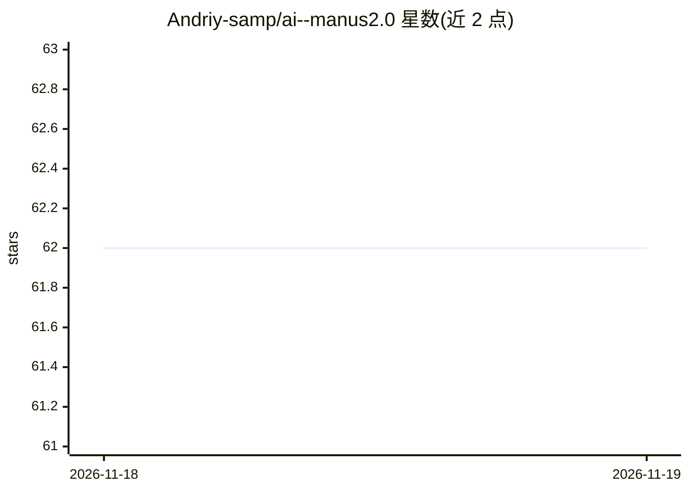

# Andriy-samp/ai--manus2.0

⭐ 62 · Apache-2.0 · 推送 2026-11-18 · [GitHub](https://github.com/Andriy-samp/ai--manus2.0) · 个人维护

**面向个人用户的自主 AI Agent，可代为执行代码与浏览器操作**

README 描述 Manus 为通用自主 AI Agent：代表用户运行代码脚本、控制浏览器（导航网页、填写表单、采集信息），并以后台个人助手形式处理多步任务。定位为面向家庭、学习与轻量办公场景的辅助工具，强调无需编程背景、跨会话保持任务模式。文中提供兼容性要求表（64 位系统、4GB 起 RAM）与六步启动流程，未给出具体安装命令或下载链接细节。

## 筛选速览

| 维度 | 判定 | 备注 |
|---|---|---|
| AI 角色 | `ai-native` | 本体是模型或模型工具 |
| 许可风险 | `permissive` | Apache-2.0 |
| 部署形态 | `None` |  |
| 模型依赖 | — | README 未给出锁定关系 |
| 硬件要求 | — | 无带数字的原话,不猜 |
| 安装摩擦 | `low` | 无编译、无系统依赖或容器化 |
| 成熟度 | — | 结构信号不足 |

## 能力要点

- 自主执行代码脚本完成任务
- 浏览器控制：导航、填表、采集信息
- 后台个人助手形式处理多步日常任务
- 提供系统/内存等兼容性要求表

## 适用场景

- 收集资料并整理学习笔记
- 从多个网页采集数据
- 自动化重复性文件检查与小脚本测试

## 场景标签

`AI 助手` `浏览器自动化` · 领域:效率与自动化

## 证据(README 行号)

> L10: - **Autonomous Code Execution:** Manus AI agent runs code on its own to complete tasks, so you can focus on decisio
> L18: Manus is an autonomous AI agent designed to run code and control a browser on your behalf. Instead of acting like a

## 星数曲线

2026-11-18 62 → 2026-11-19 62（+0）

---
*卡片 v1 · prompt 1.4 · 生成 2026-11-19 · 置信度 mid · 依据 README sha `52f78133c85b` · [字段定义](../../DATASET.md)*
