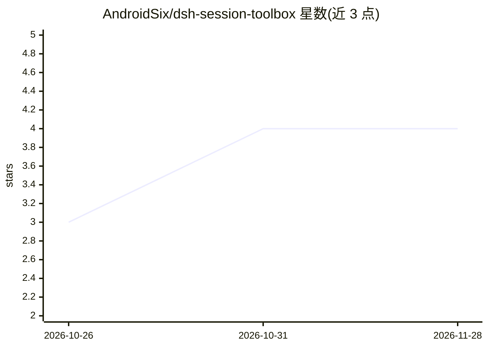

# AndroidSix/dsh-session-toolbox

⭐ 4 · JavaScript · MIT · 推送 2026-10-23 · [GitHub](https://github.com/AndroidSix/dsh-session-toolbox) · 个人维护 · 中文 README

**为 DeepSeek Harness 补充会话管理的第三方插件**

以插件形式扩展 DeepSeek Harness（DSH）：图片草稿备份、会话跨项目迁移、归档池、项目分组排序、文件检查点恢复、多引用回复、后续任务联想与历史消息删除。数据存本机（IndexedDB 与 ~/.dsh/session-toolbox/），不改官方安装包。安装方式为在 DSH 插件页输入包名或从源码 npm pack 构建 tgz；宿主版本与 Node 版本有明确范围约束，检查点仅支持本地项目普通文件且有大小与保留期上限。

## 筛选速览

| 维度 | 判定 | 备注 |
|---|---|---|
| AI 角色 | `ai-enhanced` | 去掉 AI 部分产品仍成立 |
| 许可风险 | `permissive` | MIT |
| 部署形态 | `library` | 以包/库形式分发 |
| 模型依赖 | — | README 未给出锁定关系 |
| 硬件要求 | — | 无带数字的原话,不猜 |
| 安装摩擦 | `low` | 无编译、无系统依赖或容器化 |
| 成熟度 | — | 结构信号不足 |

## 能力要点

- 图片草稿保险箱：备份未发送图片，切会话后恢复
- 文件检查点：按消息粒度预览并撤销文件修改，保留聊天记录
- 项目分组与会话迁移：迁移保留顺序、归档、置顶
- 后续任务联想：每轮最多 3 条候选，独立模型与独立 token 统计

## 适用场景

- 备份切换会话时未发送的图片草稿
- 把已有会话整体迁到新的项目目录
- 回滚某条消息之后的文件修改而保留对话
- 为每轮回答联想后续任务并单独计量用量

## 场景标签

`AI 助手` · 领域:对话与助手

## 证据(README 行号)

> L3: 给 DeepSeek Harness（DSH）补上图片草稿备份、会话迁移、归档池、项目分组、引用回复与文件检查点。
> L5: 第三方插件 · MIT · 不修改 DSH 官方安装包 · 数据保存在本机。
> L27: |后续任务联想|每轮结束后生成最多 3 条候选，点击填入输入框，由用户发送；可独立指定模型，默认跟随会话，独立统计 token 用量。|

## 星数曲线

2026-10-26 3 → 2026-11-28 4（+1）

---
*卡片 v1 · prompt 1.4 · 生成 2026-11-21 · 置信度 high · 依据 README sha `bff480b6e6d9` · [字段定义](../../DATASET.md)*
