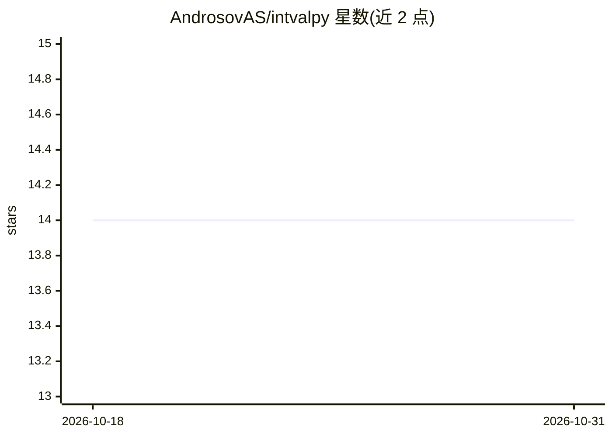

# AndrosovAS/intvalpy

⭐ 14 · Python · MIT · 推送 2026-04-25 · [GitHub](https://github.com/AndrosovAS/intvalpy) · [官网](https://intvalpy.readthedocs.io) · 个人维护

**Python 区间运算库：解区间方程组并可视化解集**

实现代数封闭的区间算术，用于区间计算：求解线性与非线性区间方程组（Krawczyk、Hansen-Sengupta 方法）、PSS 外部估计、区间全局优化、基于最大误差信息的数据拟合，以及多面体解集与 N 维切片可视化。面向科研与数值计算开发者，通过 pip 安装，无概率分布假设即可处理含误差数据。

## 筛选速览

| 维度 | 判定 | 备注 |
|---|---|---|
| AI 角色 | `ai-enhanced` | 去掉 AI 部分产品仍成立 |
| 许可风险 | `permissive` | MIT |
| 部署形态 | `library` | 以包/库形式分发 |
| 模型依赖 | — | README 未给出锁定关系 |
| 硬件要求 | — | 无带数字的原话,不猜 |
| 安装摩擦 | `low` | 无编译、无系统依赖或容器化 |
| 成熟度 | — | 结构信号不足 |

## 能力要点

- 区间线性/非线性方程组求解（Krawczyk、Hansen-Sengupta）
- PSS 混合方法给出 ISLAE 联合解集的外部估计
- 仅需误差界信息的数据拟合方法
- 解集多面体可视化与 N 维切片

## 适用场景

- 对含测量误差的数据做参数估计与函数拟合
- 求解并可视化区间线性方程/不等式组的解集
- 区间全局优化问题求解

## 场景标签

`科研工具` · 领域:学习与行业

## 证据(README 行号)

> L3: The Python module implements an algebraically closed interval arithmetic for interval computations, solving interval
> L4: linear and nonlinear equations, and visualizing solution sets for interval systems of equations.

## 星数曲线

2026-10-18 14 → 2026-10-31 14（+0）

---
*卡片 v1 · prompt 1.4 · 生成 2026-10-31 · 置信度 mid · 依据 README sha `a882feaccd10` · [字段定义](../../DATASET.md)*
