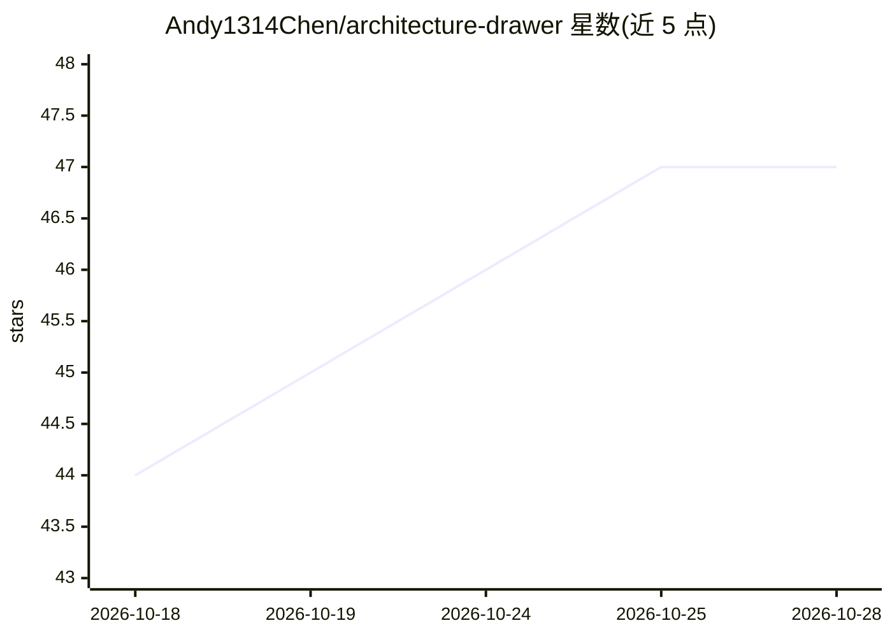

# Andy1314Chen/architecture-drawer

⭐ 47 · Python · MIT · 推送 2026-08-31 · [GitHub](https://github.com/Andy1314Chen/architecture-drawer) · 个人维护 · 中文 README

**给 AI 编程 agent 的技能：文本架构描述生成可编辑 PPT 图**

面向 Claude Code、Codex、Gemini CLI、Cursor、Copilot 等 AI 编程 agent 的 Agent Skills 技能包：用户提交系统架构的文字描述，agent 据此生成 gen.py 与 SVG，经 13 维评估器自动检查重叠/悬空/交叉并按分数自动修正（≥80 视为结构合格），再通过 svg_to_pptx 导出为原生 PowerPoint 形状（可拖拽、改色、改字）。仓库本身作为 Claude Code 插件市场分发，也支持复制到各平台 skills 目录安装。运行需 python-pptx、rsvg-convert、pytest。

## 筛选速览

| 维度 | 判定 | 备注 |
|---|---|---|
| AI 角色 | `ai-ecosystem` | LLM/agent 周边工具 |
| 许可风险 | `permissive` | MIT |
| 部署形态 | `library` | 以包/库形式分发 |
| 模型依赖 | locked-api |  |
| 硬件要求 | — | 无带数字的原话,不猜 |
| 安装摩擦 | `low` | 无编译、无系统依赖或容器化 |
| 成熟度 | — | 结构信号不足 |

## 能力要点

- 文本描述 → SVG → 原生 PowerPoint 形状的生成流水线
- 13 维评估器自动检测重叠/悬空/交叉，低分时 auto_refine 修正
- 以插件市场与 Agent Skills 目录两种方式分发，覆盖多平台 agent
- evals 目录兼作回归测试集，含 agent 回放层测试

## 适用场景

- 让 Claude Code / Codex 等 agent 把我的系统架构描述转成可编辑 PPT 图
- 为开源项目快速产出可再编辑的架构示意图
- 在 PPT 中直接微调生成图的配色、字体与布局

## 场景标签

 · 领域:开发工具/图表生成

## 证据(README 行号)

> L5: A skill for Claude Code, Codex, Open Code, Pi Agent, and other AI coding agents: turn a text description of your sys
> L51: ## Install (Claude Code)
> L71: > Codex CLI fully supports the Agent Skills directory structure.

## 星数曲线

2026-10-18 44 → 2026-10-28 47（+3）

---
*卡片 v1 · prompt 1.4 · 生成 2026-10-25 · 置信度 mid · 依据 README sha `6afd459d8063` · [字段定义](../../DATASET.md)*
