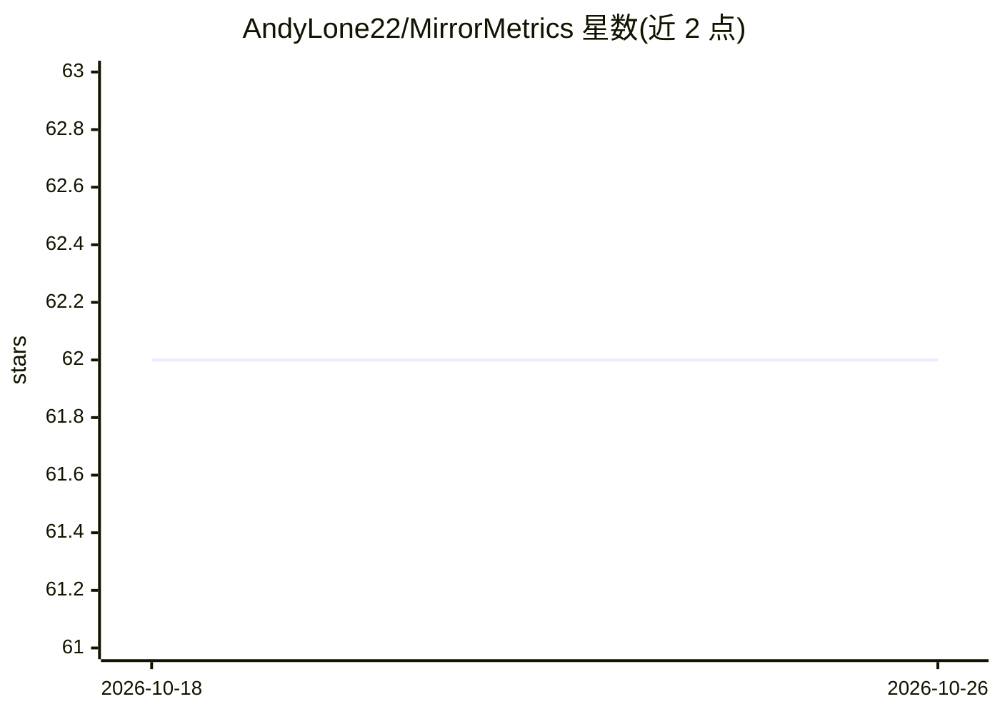

# AndyLone22/MirrorMetrics

⭐ 62 · Python · MIT · 推送 2026-02-21 · [GitHub](https://github.com/AndyLone22/MirrorMetrics) · [官网](https://civitai.com/articles/26241) · 个人维护

**Face LoRA 训练诊断工具：用 InsightFace 生物特征分析过拟合与数据集质量**

面向 Stable Diffusion Face LoRA 训练者的本地评测脚本：将训练参考图放入 Reference_Images、生成图按 LoRA 分文件夹放入 Lora_Candidates，脚本用 InsightFace（ArcFace）计算人脸嵌入余弦相似度，生成 7 面板 Plotly 交互式 HTML 仪表盘、Copycat 检测报告与 CSV 原始数据。指标覆盖身份一致性（含 Leave-One-Out 评分）、姿态/年龄分布、t-SNE 身份聚类与 Black Hole 主导样本排名，用于判断过拟合与数据集离群点。全部本地运行，不上传图片；NVIDIA GPU 为推荐项，CPU 亦可运行。

## 筛选速览

| 维度 | 判定 | 备注 |
|---|---|---|
| AI 角色 | `ai-native` | 本体是模型或模型工具 |
| 许可风险 | `permissive` | MIT |
| 部署形态 | `library` | 以包/库形式分发 |
| 模型依赖 | — | README 未给出锁定关系 |
| 硬件要求 | `cpu-ok` | |
| 安装摩擦 | `medium` | 含编译或系统依赖之一 |
| 成熟度 | — | 结构信号不足 |

## 能力要点

- ArcFace 嵌入余弦相似度度量 LoRA 生成图与参考集的身份一致性
- 7 面板交互式 Plotly 仪表盘 + Copycat 最近邻配对报告 + CSV 导出
- Leave-One-Out 评分识别参考集离群图，Black Hole 排名定位主导训练样本
- 全程本地运行，无图片上传；CPU 可运行，首次运行自动下载 buffalo_l 模型（约 300MB）

## 适用场景

- 训练后判断 LoRA 是否过拟合/记忆了训练图而非学会概念
- 训练前检查数据集是否存在离群/毒图
- 横向对比多个不同设置训练出的 LoRA 的身份一致性与灵活性

## 场景标签

`模型评测` · 领域:评测与运维

## 证据(README 行号)

> L6: **MirrorMetrics** is a scientific benchmarking tool for evaluating **Face LoRAs** (Stable Diffusion fine-tuned model
> L35: |🧬 **Biometric Similarity**|Cosine similarity between face embeddings and a reference centroid|

## 星数曲线

2026-10-18 62 → 2026-10-26 62（+0）

---
*卡片 v1 · prompt 1.4 · 生成 2026-10-24 · 置信度 mid · 依据 README sha `ca79e4a58afc` · [字段定义](../../DATASET.md)*
