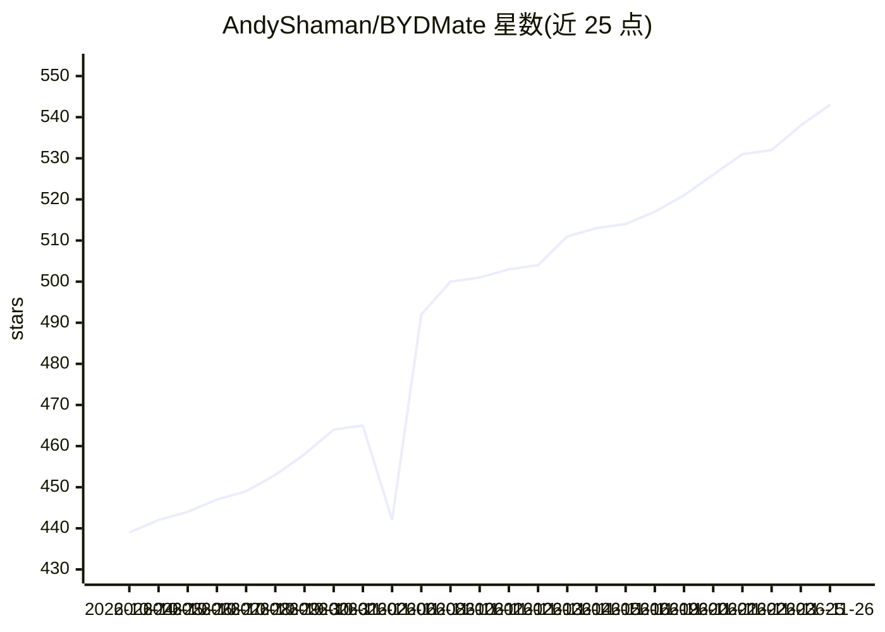

# AndyShaman/BYDMate

⭐ 543 · Kotlin · NOASSERTION · 推送 2026-11-20 · [GitHub](https://github.com/AndyShaman/BYDMate) · [官网](https://ai-handler.com/#bydmate) · 个人维护 · 中文 README

**BYD 车主的 DiLink 增强应用：真实能耗、行程日志与语音助手**

面向 BYD DiLink 车机的 Android（Kotlin/Jetpack Compose）应用：直接读取 BMS 数据显示真实能耗、GPS 行程与充电记录、健康度与诊断码读取、WHEN→THEN 自动化规则、分屏 1/3+2/3、仪表盘应用投送、HUD 导航提示、盲区摄像头随转向灯显示、俄语离线语音助手（30+ 工具）、ABRP 遥测。核心功能本地运行不联网，云功能默认关闭需手动输入密钥；对制动、转向、ADAS 等系统无控制命令，并对开窗/开门等操作设置车速限制。

## 筛选速览

| 维度 | 判定 | 备注 |
|---|---|---|
| AI 角色 | `ai-enhanced` | 去掉 AI 部分产品仍成立 |
| 许可风险 | `none` | NOASSERTION |
| 部署形态 | `None` |  |
| 模型依赖 | — | README 未给出锁定关系 |
| 硬件要求 | — | 无带数字的原话,不猜 |
| 安装摩擦 | `low` | 无编译、无系统依赖或容器化 |
| 成熟度 | — | 结构信号不足 |

## 能力要点

- 读取 BMS（energydata）显示真实能耗与 25 km 滑动窗口趋势
- 俄语离线语音助手：端侧语音识别、30+ 工具、神经网络语音合成
- WHEN→THEN 自动化规则与速度限制安全约束（CAN/shell 命令被屏蔽）
- 仪表盘投送、HUD、分屏 1/3+2/3、盲区摄像头随转向灯

## 适用场景

- 查看官方仪表低估的真实电耗与停车耗电
- 记录并分析每次充电与行程成本
- 用语音助手俄语控制车窗、空调等车载功能
- 把导航或摄像头画面投送到仪表盘

## 场景标签

`语音 Agent` `语音识别` `语音合成` · 领域:对话与助手

## 证据(README 行号)

> L5: ### Trip Logger & Energy Analytics & Touch of Magic for BYD DiLink
> L77: |**AI**|Инсайты|Анализ вождения: локальные правила на устройстве, без интернета|
> L88: |**Voice**|Голосовой агент|Русский офлайн-ассистент: распознавание речи на устройстве, AI-агент (больше 30 инструме

## 星数曲线

2026-10-24 439 → 2026-11-26 543（+104）

---
*卡片 v1 · prompt 1.4 · 生成 2026-11-25 · 置信度 high · 依据 README sha `41249bc3245b` · [字段定义](../../DATASET.md)*
