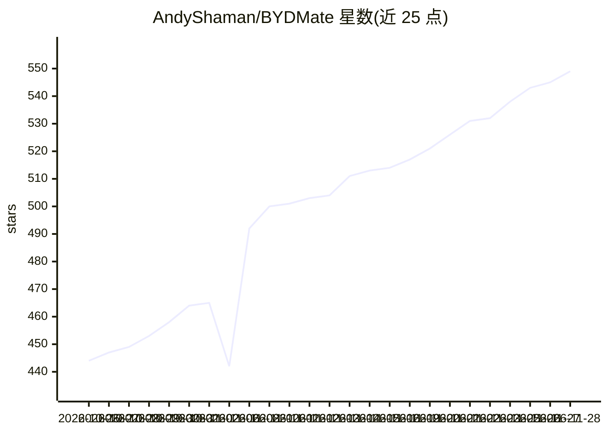

# AndyShaman/BYDMate

⭐ 549 · Kotlin · NOASSERTION · 推送 2026-11-27 · [GitHub](https://github.com/AndyShaman/BYDMate) · [官网](https://ai-handler.com/#bydmate) · 个人维护 · 中文 README

**面向 BYD DiLink 车主的能耗记录与车控扩展 Android 应用**

运行在 BYD DiLink 车机上的 Android 应用（Kotlin/Jetpack Compose），直接读取 BMS 数据显示实际能耗，提供 GPS 行程记录、AC/DC 充电日志、WHEN→THEN 自动化规则、仪表盘应用投射、HUD 导航投射、分屏、盲区摄像头、DTC 故障码读取、胎压传感器写入、ABRP 遥测与配置备份。核心功能在车机本地运行、无需联网；另提供俄语离线语音助手（设备端语音识别、30+ 工具的 AI agent）与本地 AI 驾驶分析。官方声明不触碰制动、转向、ADAS 与安全气囊，并设速度限制与确认窗口等安全约束。

## 筛选速览

| 维度 | 判定 | 备注 |
|---|---|---|
| AI 角色 | `ai-enhanced` | 去掉 AI 部分产品仍成立 |
| 许可风险 | `none` | NOASSERTION |
| 部署形态 | `None` |  |
| 模型依赖 | — | README 未给出锁定关系 |
| 硬件要求 | — | 无带数字的原话,不猜 |
| 安装摩擦 | `low` | 无编译、无系统依赖或容器化 |
| 成熟度 | — | 结构信号不足 |

## 能力要点

- 从 BMS (energydata) 读取实际能耗，25 km 滑动窗口趋势
- WHEN→THEN 自动化规则与俄语离线语音 agent（30+ 工具）
- 仪表盘投射、HUD、分屏 1/3+2/3、盲区摄像头按转向灯触发
- DTC 故障码读取与清除（仅 P 档手动确认）、配置备份到 Telegram bot

## 适用场景

- 查看 BYD 官方行车电脑低报的实际电耗与停放能耗
- 记录行程与充放电并做成本统计
- 编写规则自动化控制车窗、空调、后备箱等功能
- 用俄语语音助手免手操作车控功能

## 场景标签

`语音 Agent` `工作流自动化` · 领域:效率与自动化

## 证据(README 行号)

> L28: Все основные функции (поездки, зарядки, автоматизации, локальные инсайты, офлайн голосовой агент) работают локально
> L83: |**Rules**|Автоматизация|Правила WHEN→THEN: триггеры по параметрам → команды управления машиной|
> L88: |**Voice**|Голосовой агент|Русский офлайн-ассистент: распознавание речи на устройстве, AI-агент (больше 30 инструме

## 星数曲线

2026-10-26 444 → 2026-11-28 549（+105）

---
*卡片 v1 · prompt 1.4 · 生成 2026-11-28 · 置信度 mid · 依据 README sha `b26d422229cc` · [字段定义](../../DATASET.md)*
