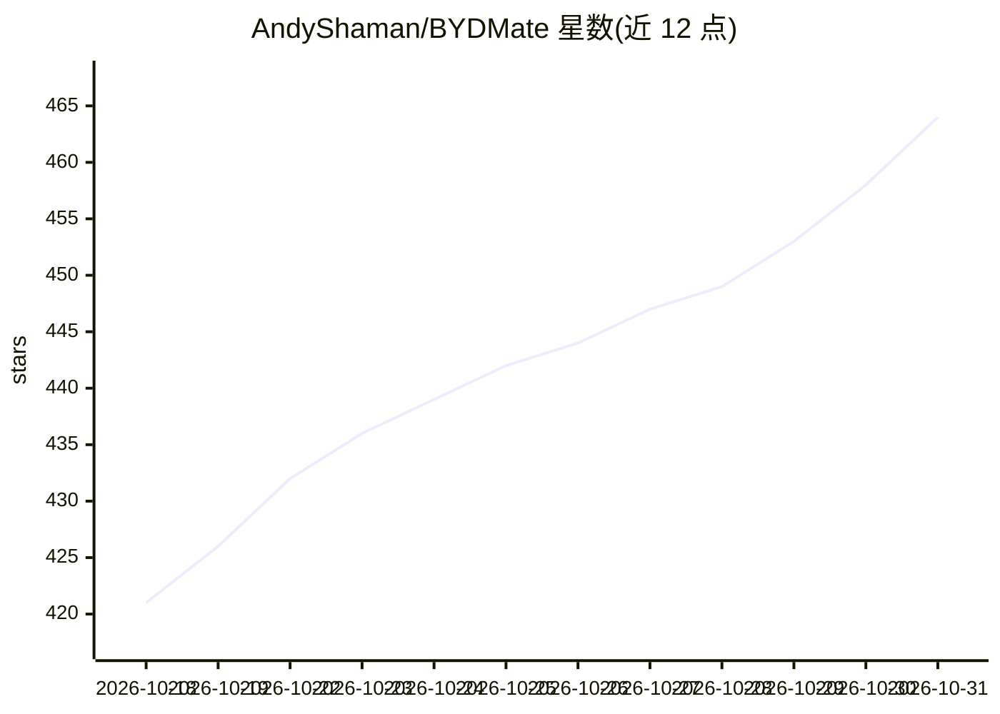

# AndyShaman/BYDMate

⭐ 464 · Kotlin · NOASSERTION · 推送 2026-10-29 · [GitHub](https://github.com/AndyShaman/BYDMate) · [官网](https://ai-handler.com/#bydmate) · 个人维护 · 中文 README

**BYD DiLink 车机扩展应用：行程记录、真实能耗与本地 AI 功能**

面向 BYD 电动车与 DM-i/DM-o 混动车（Leopard 3、Atto 3、Seal、汉等）车主的 Android 车机应用，用 Kotlin/Jetpack Compose 编写。从 BMS 读取真实能耗数据（官方行车电脑被指低估 10-30%），提供 GPS 行程记录、充电日志、电池健康监测、WHEN→THEN 自动化规则、仪表盘导航提示、HUD 投影、盲区摄像头与分屏。AI 部分：设备端本地驾驶分析洞察、离线俄语语音助手（32 个工具、设备端语音识别与神经网络合成），主要功能离线运行，云功能默认关闭。

## 筛选速览

| 维度 | 判定 | 备注 |
|---|---|---|
| AI 角色 | `ai-enhanced` | 去掉 AI 部分产品仍成立 |
| 许可风险 | `none` | NOASSERTION |
| 部署形态 | `None` |  |
| 模型依赖 | — | README 未给出锁定关系 |
| 硬件要求 | — | 无带数字的原话,不猜 |
| 安装摩擦 | `low` | 无编译、无系统依赖或容器化 |
| 成熟度 | `idea` | |

## 能力要点

- 直读 BMS 数据显示真实能耗，含静止时段与电芯压差
- WHEN→THEN 规则引擎控制车窗/空调/电池加热等，触发器含车速、SOC、转向灯、地理围栏
- 离线俄语语音助手（32 个可调用工具）与设备端驾驶分析洞察
- 支持 DiLink 3.0–5.1 及 UI7 固件，自动识别 DM-i/DM-o 混动车型

## 适用场景

- 查看 BYD 车辆的真实电耗与百公里成本，替代低估的车载电脑数据
- 按 SOC、温度、时间等条件自动控制车窗、空调与电池加热
- 记录并分析行程、充电与电池健康数据
- 把导航提示投到仪表盘和 HUD、用转向灯触发盲区摄像头

## 场景标签

`语音 Agent` `工作流自动化` · 领域:效率与自动化

## 证据(README 行号)

> L57: |**AI**|Инсайты|Анализ вождения: локальные правила на устройстве, без интернета|
> L67: |**Voice**|Голосовой агент|Русский офлайн-ассистент: распознавание речи на устройстве, AI-агент (32 инструмента), н

## 星数曲线

2026-10-18 421 → 2026-10-31 464（+43）

---
*卡片 v1 · prompt 1.4 · 生成 2026-10-22 · 置信度 high · 依据 README sha `023b759e89e9` · [字段定义](../../DATASET.md)*
