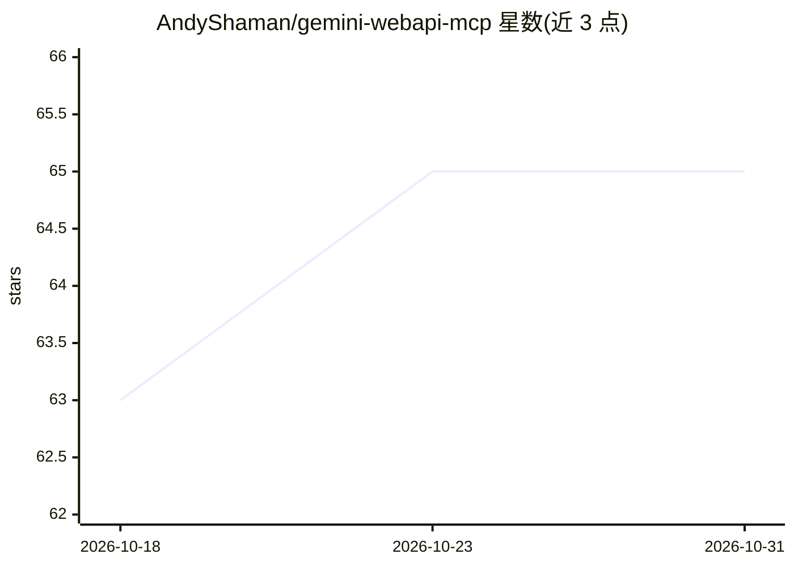

# AndyShaman/gemini-webapi-mcp

⭐ 65 · Python · AGPL-3.0 · 推送 2026-09-21 · [GitHub](https://github.com/AndyShaman/gemini-webapi-mcp) · [官网](https://ai-handler.com/#gemini-webapi-mcp) · 个人维护

**通过浏览器 cookies 接入 Gemini 的 MCP 服务器：图像生成、编辑与聊天**

基于 Python 的 MCP stdio 服务器，通过读取 Chrome cookies 登录 gemini.google.com（无需 API key），向 MCP 客户端（如 Claude Code、Claude Desktop）提供 6 个工具：文本生成图像（Nano Banana 2，支持比例）、图像编辑、文件分析（视频/PDF/文档）、URL 分析、文本聊天与多轮会话。自动下载 2x 高分辨率版本，并以确定性 Reverse Alpha Blending 去除 Gemini 水印。基于 gemini-webapi 逆向库，AGPL-3.0 许可。

## 筛选速览

| 维度 | 判定 | 备注 |
|---|---|---|
| AI 角色 | `ai-ecosystem` | LLM/agent 周边工具 |
| 许可风险 | `viral` | AGPL-3.0 |
| 部署形态 | `None` |  |
| 模型依赖 | — | README 未给出锁定关系 |
| 硬件要求 | — | 无带数字的原话,不猜 |
| 安装摩擦 | `low` | 无编译、无系统依赖或容器化 |
| 成熟度 | — | 结构信号不足 |

## 能力要点

- Chrome cookies 自动认证，无需 API key（browser-cookie3）
- 图像生成/编辑（Nano Banana 2）并自动下载 2x 高分辨率版本
- 内置确定性算法去除 Gemini sparkle 水印（无外部 ML 模型）
- 提供 gemini_chat / upload_file / analyze_url 等 6 个 MCP 工具

## 适用场景

- 在 Claude Code 或 Claude Desktop 中直接调用 Gemini 生成和编辑图像
- 让 MCP 客户端用 Gemini 分析视频、PDF 和网页内容
- 无 Gemini API key 时通过网页版账号使用 Gemini 能力

## 场景标签

`图像生成` `文档问答` · 领域:内容生成

## 证据(README 行号)

> L3:  MCP-сервер для Google Gemini — генерация и редактирование изображений, чат и анализ файлов через браузерные cookies
> L173: |Инструмент|Описание|
> L178: |`gemini_chat`|Текстовый чат (одиночный или multi-turn)|

## 星数曲线

2026-10-18 63 → 2026-10-31 65（+2）

---
*卡片 v1 · prompt 1.4 · 生成 2026-10-24 · 置信度 high · 依据 README sha `f841bbde775d` · [字段定义](../../DATASET.md)*
