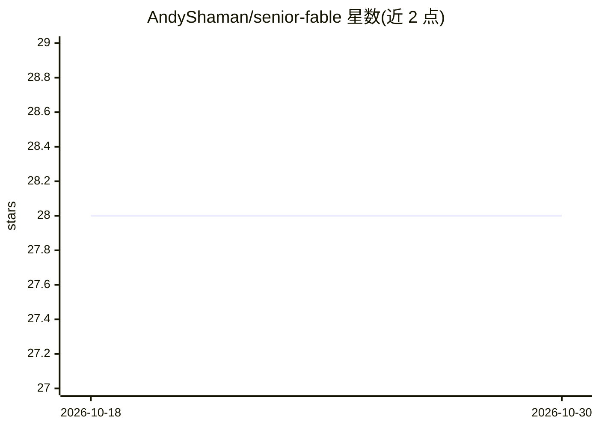

# AndyShaman/senior-fable

⭐ 28 · MIT · 推送 2026-10-29 · [GitHub](https://github.com/AndyShaman/senior-fable) · [官网](https://ai-handler.com/#senior-fable) · 个人维护

**Claude Code 插件：让顶级模型当技术主管，廉价子代理干活**

面向 Claude Code 的多代理编排插件：会话中的顶级模型承担分解、架构、争议决策与最终综合，其余工作路由给更便宜的子代理——实现者做功能级编码、worker 做机械任务、只读 investigator 做长线调查、独立 reviewer 审查成品。子代理在独立上下文窗口运行并只返回结论，以节省顶级模型的使用额度并保护主上下文。角色默认映射到 opus/sonnet 别名，可通过 CLAUDE.md 的 roster 块按角色覆盖模型与 effort；要求会话本身运行在最强档模型上。

## 筛选速览

| 维度 | 判定 | 备注 |
|---|---|---|
| AI 角色 | `ai-ecosystem` | LLM/agent 周边工具 |
| 许可风险 | `permissive` | MIT |
| 部署形态 | `None` |  |
| 模型依赖 | locked-api |  |
| 硬件要求 | — | 无带数字的原话,不猜 |
| 安装摩擦 | `low` | 无编译、无系统依赖或容器化 |
| 成熟度 | — | 结构信号不足 |

## 能力要点

- 编排者–工作者模式：lead/implementer/worker/investigator/reviewer 五角色分工
- 子代理独立上下文运行，仅返回提炼结论
- observer 角色在 harness 层禁用 Write/Edit，执行写作者–验证者分离与盲审
- 通过 CLAUDE.md roster 块按角色覆盖模型与 effort，无需 fork

## 适用场景

- 在 Claude Code 中让昂贵模型只做判断、便宜模型做执行以节省额度
- 长调查任务交给只读子代理，避免污染主对话上下文
- 跨角色独立审查已完成的代码改动

## 场景标签

`多智能体` `编码 Agent` · 领域:Agent 开发

## 证据(README 行号)

> L9: **Senior Fable** is a Claude Code plugin that turns your top-tier session model into a **tech lead**: it keeps decom
> L20: Senior Fable fixes both with an orchestrator–worker pattern: subagents run in their own context windows and return 

## 星数曲线

2026-10-18 28 → 2026-10-30 28（+0）

---
*卡片 v1 · prompt 1.4 · 生成 2026-10-26 · 置信度 high · 依据 README sha `04f5d24ca26c` · [字段定义](../../DATASET.md)*
