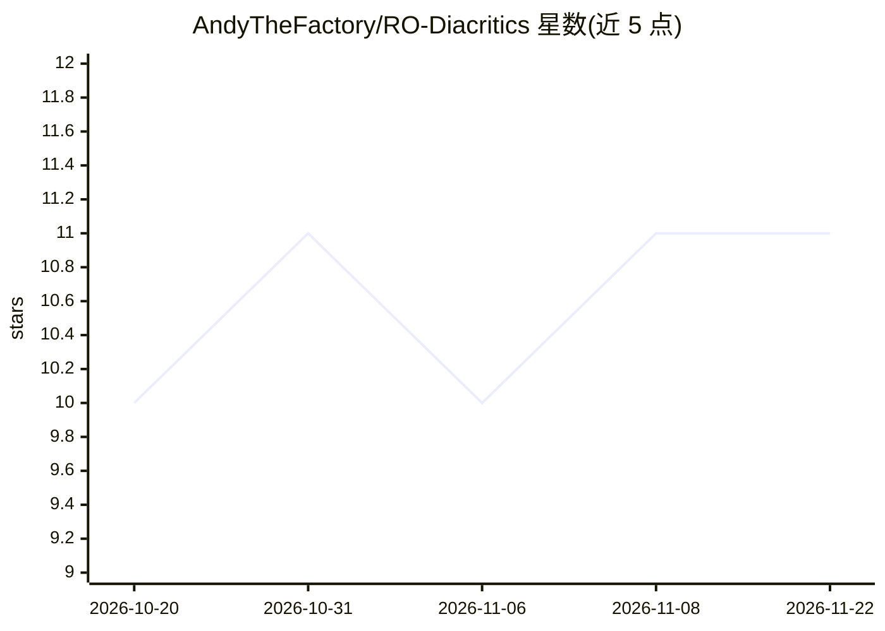

# AndyTheFactory/RO-Diacritics

⭐ 11 · Python · MIT · 推送 2026-04-24 · [GitHub](https://github.com/AndyTheFactory/RO-Diacritics) · 个人维护

**罗马尼亚语变音符号恢复的 Python 模块**

基于深度学习模型的罗马尼亚语变音符号恢复模块：输入无变音的罗马尼亚语文本，输出补全变音符号的文本，支持对字符串直接处理，也支持对 pandas DataFrame 列批量应用。依赖 torch、torchtext、numpy，训练需 nltk 与 scikit-learn，分词需 nltk 的 punkt 资源。方法基于 Ruseti 等人 2020 年的循环神经网络论文。通过 pip 从 PyPI 安装。

## 筛选速览

| 维度 | 判定 | 备注 |
|---|---|---|
| AI 角色 | `ai-native` | 本体是模型或模型工具 |
| 许可风险 | `permissive` | MIT |
| 部署形态 | `library` | 以包/库形式分发 |
| 模型依赖 | — | README 未给出锁定关系 |
| 硬件要求 | — | 无带数字的原话,不猜 |
| 安装摩擦 | `low` | 无编译、无系统依赖或容器化 |
| 成熟度 | — | 结构信号不足 |

## 能力要点

- 提供 restore_diacritics 函数恢复罗马尼亚语变音符号
- 支持 pandas DataFrame 列批量处理
- 基于循环神经网络的已发表方法
- pip 一行命令安装

## 适用场景

- 修复罗马尼亚语文本缺失的变音符号
- 批量清洗 pandas 数据表中的罗马尼亚语语料

## 场景标签

 · 领域:自然语言处理

## 证据(README 行号)

> L3: **RO Diacritics** is a straightforward diacritics restoration module for Romanian Language
> L7: print(restore_diacritics("fara poezie, viata e pustiu"))

## 星数曲线

2026-10-20 10 → 2026-11-22 11（+1）

---
*卡片 v1 · prompt 1.4 · 生成 2026-11-19 · 置信度 high · 依据 README sha `28bc96627d5f` · [字段定义](../../DATASET.md)*
