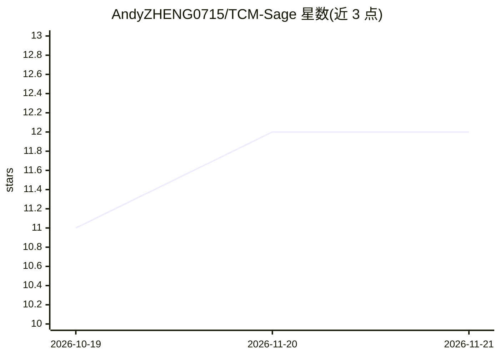

# AndyZHENG0715/TCM-Sage

⭐ 12 · Python · MIT · 推送 2026-10-25 · [GitHub](https://github.com/AndyZHENG0715/TCM-Sage) · [官网](https://tcm-sage-sandy.vercel.app) · 个人维护 · 中文 README

**面向中医从业者：基于RAG的古籍循证问答助手**

为中医从业者提供的循证综合工具：对 17 部经典古籍（372 万字、12,204 块）建立 ChromaDB 向量索引，混合向量检索与 SymMap 2.0 知识图谱（NetworkX，18,450 实体），检索后经 qwen3-rerank 重排。生成侧采用查询分类路由（按临床严重度调温度）与 Self-RAG 式自评校验，所有回答附原文出处引用。部署形态为 Next.js 前端 + FastAPI 后端 + CLI，另有公开预览站点与盲评 Arena 统计页。实时检索需访问码，托管服务商可用性不做保证，明确声明非医疗建议。

## 筛选速览

| 维度 | 判定 | 备注 |
|---|---|---|
| AI 角色 | `ai-native` | 本体是模型或模型工具 |
| 许可风险 | `permissive` | MIT |
| 部署形态 | `desktop` | 安装包/桌面程序 |
| 模型依赖 | — | README 未给出锁定关系 |
| 硬件要求 | — | 无带数字的原话,不猜 |
| 安装摩擦 | `low` | 无编译、无系统依赖或容器化 |
| 成熟度 | `idea` | |

## 能力要点

- 17 部中医经典 12,204 块的 BGE-M3/ChromaDB 持久化索引
- 向量检索 + SymMap 2.0 知识图谱的混合检索与 jieba 实体匹配
- 查询分类路由与 Self-RAG 式自评，回答附章节级原文引用
- 盲评 A/B Arena，含配对 T 检验与可下载图表

## 适用场景

- 门诊时快速查询古籍中对证条文并核对原文出处
- 比较 RAG 增强回答与普通 LLM 回答的差异
- 可视化探索症状—草药—方剂的知识图谱关系

## 场景标签

`RAG` `文档问答` `知识图谱` · 领域:知识与检索

## 证据(README 行号)

> L11: **TCM-Sage** is an evidence-synthesis tool for Traditional Chinese Medicine (TCM) practitioners. This project aims 
> L19: The system is built on a Modular RAG paradigm to handle the complexities of classical Chinese texts.
> L21: 2. **Knowledge Base:** 17 classical TCM texts (3.72M characters) including the four canonical works (《黄帝内经》《伤寒论》《金匮

## 星数曲线

2026-10-19 11 → 2026-11-21 12（+1）

---
*卡片 v1 · prompt 1.4 · 生成 2026-11-19 · 置信度 high · 依据 README sha `899922ebe434` · [字段定义](../../DATASET.md)*
