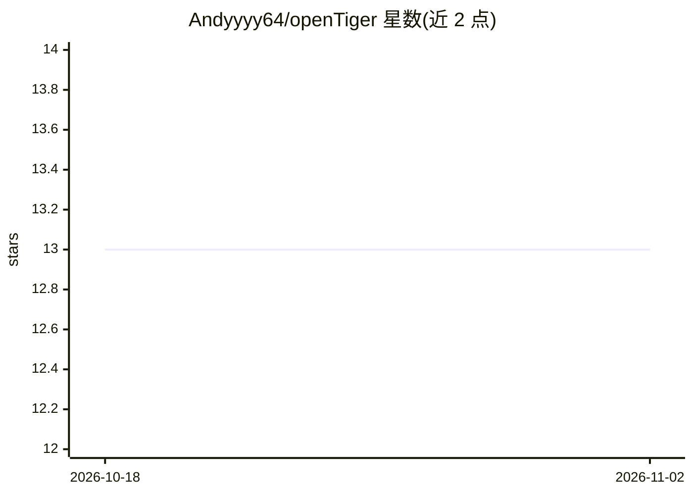

# Andyyyy64/openTiger

⭐ 13 · TypeScript · MIT · 推送 2026-10-29 · [GitHub](https://github.com/Andyyyy64/openTiger) · [官网](https://opentiger.dev/) · 个人维护

**多 agent 自主开发编排系统：需求到 PR 的持续收敛流水线**

面向开发者的自主开发编排运行时：从需求/Issue 接入开始，经 Planner 生成任务、Dispatcher 分发，由 worker/tester/docser 三种角色执行实现、测试与文档更新，judge 评估产出并驱动合并或返工，cycle manager 负责收敛、重试与重规划循环。状态持久化依赖 PostgreSQL + Redis，支持主机进程与 Docker 沙箱两种执行模式，提供 Dashboard、API 与对话式聊天界面控制流程，并以插件机制扩展功能（参考实现 TigerResearch）。执行器可选 ClaudeCode、Codex 等；声明不保证所有外部条件下一次性成功，设计目标是避免静默停滞并持续收敛。

## 筛选速览

| 维度 | 判定 | 备注 |
|---|---|---|
| AI 角色 | `ai-ecosystem` | LLM/agent 周边工具 |
| 许可风险 | `permissive` | MIT |
| 部署形态 | `self-host` | docker 或自建部署 |
| 模型依赖 | — | README 未给出锁定关系 |
| 硬件要求 | — | 无带数字的原话,不猜 |
| 安装摩擦 | `low` | 无编译、无系统依赖或容器化 |
| 成熟度 | — | 结构信号不足 |

## 能力要点

- Planner/Dispatcher/Worker/Tester/Judge/Cycle Manager 多角色编排循环
- 恢复优先的状态机运行（quota_wait / awaiting_judge / needs_rework）
- 主机进程与 Docker 沙箱运行时切换，PostgreSQL+Redis 持久化
- 插件化扩展，TigerResearch 为参考实现；提供 Dashboard 与 API

## 适用场景

- 让 agent 团队从需求或 Issue 自动完成实现、测试与文档并产出 PR
- 长期运行的自主仓库工作流，失败后自动恢复与重规划
- 通过聊天界面输入需求并监控任务、运行与判定记录

## 场景标签

`多智能体` `编码 Agent` · 领域:Agent 开发

## 证据(README 行号)

> L42: - **Planner**: generates tasks from requirements/issues
> L44: - **Worker/Tester/Docser**: executes task changes and verification
> L46: - **Cycle Manager**: convergence loop, cleanup, retry, and replan trigger

## 星数曲线

2026-10-18 13 → 2026-11-02 13（+0）

---
*卡片 v1 · prompt 1.4 · 生成 2026-10-31 · 置信度 mid · 依据 README sha `1deab0e103e1` · [字段定义](../../DATASET.md)*
