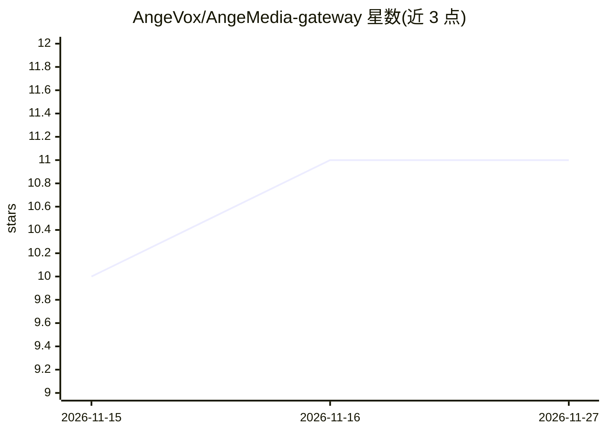

# AngeVox/AngeMedia-gateway

⭐ 11 · Python · Apache-2.0 · 推送 2026-09-13 · [GitHub](https://github.com/AngeVox/AngeMedia-gateway) · [官网](https://angehub.com/media/) · 个人维护 · 中文 README

**为 AI Agent 提供兼容 OpenAI 的图像/视频生成网关**

自托管的媒体生成网关：对外提供 OpenAI 兼容的图像与异步视频生成 API、模型路由与队列执行，内置 SQLite 任务状态，可选 Redis/Celery 后端；本地受保护存储生成与上传媒体。附带 Web Studio 运维界面（生成、任务、渠道、诊断、API key 管理）与 Prompt Copilot/Assistant。提供源码 venv、Docker Compose 及 fnOS/FYGO x86_64/ARM64 离线包三种部署方式。

## 筛选速览

| 维度 | 判定 | 备注 |
|---|---|---|
| AI 角色 | `ai-ecosystem` | LLM/agent 周边工具 |
| 许可风险 | `permissive` | Apache-2.0 |
| 部署形态 | `self-host` | docker 或自建部署 |
| 模型依赖 | — | README 未给出锁定关系 |
| 硬件要求 | — | 无带数字的原话,不猜 |
| 安装摩擦 | `low` | 无编译、无系统依赖或容器化 |
| 成熟度 | — | 结构信号不足 |

## 能力要点

- OpenAI 兼容的 /v1/images/generations 与异步 /v1/videos API
- 跨 SiliconFlow Kolors、ModelScope、Pollinations、Seedream 等渠道的成本感知图像路由
- 队列优先执行：SQLite 持久任务状态，可选 Redis/Celery 高并发后端
- Web Studio 管理界面与面向 agent 的 SKILL 文档入口

## 适用场景

- 给 AI Agent 或 OpenAI 兼容客户端统一接入多家图像/视频生成渠道
- 在 NAS 或私有环境中自托管媒体生成服务
- 通过 Web Studio 管理渠道、任务与生成的媒体资产

## 场景标签

`模型网关` `图像生成` `视频生成` · 领域:Agent 开发

## 证据(README 行号)

> L5: AngeMedia Gateway is a self-hosted image and video generation gateway for AI agents, OpenAI-compatible clients, New 
> L13: - Cost-aware image routing across SiliconFlow Kolors, ModelScope models, Pollinations, OpenAI-compatible image endp

## 星数曲线

2026-11-15 10 → 2026-11-27 11（+1）

---
*卡片 v1 · prompt 1.4 · 生成 2026-11-19 · 置信度 high · 依据 README sha `286b225c4584` · [字段定义](../../DATASET.md)*
