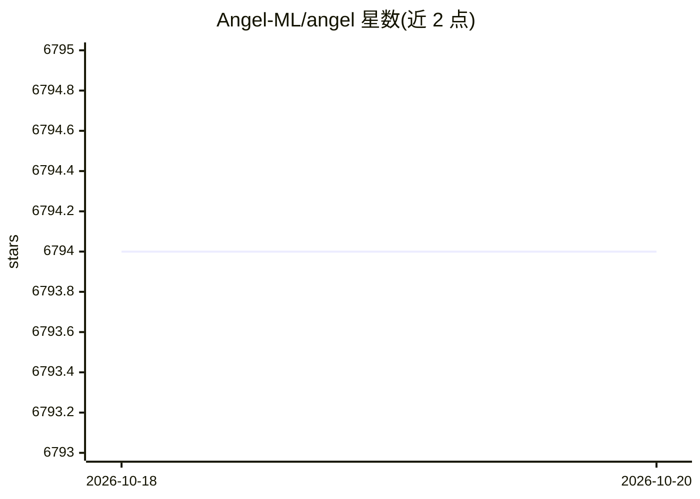

# Angel-ML/angel

⭐ 6,794 · Java · NOASSERTION · 推送 2026-10-13 · [GitHub](https://github.com/Angel-ML/angel) · 组织维护 · 中文 README

**腾讯等研发的大规模分布式机器学习参数服务器平台**

基于参数服务器（Parameter Server）理念的高性能分布式机器学习与图计算平台，由腾讯与北京大学联合开发。核心设计以模型为中心：将复杂模型参数切分到多个参数服务器节点，通过高效模型更新接口与灵活的同步一致性模型实现算法。用 Java 和 Scala 开发，支持运行在 Yarn 上，并通过 PS Service 抽象支持 Spark on Angel。内置 LR、SVM、FM、GBDT、LDA 等传统机器学习算法及 PageRank、GraphSage、GCN 等图算法；图计算与深度学习框架支持在开发中。

## 筛选速览

| 维度 | 判定 | 备注 |
|---|---|---|
| AI 角色 | `ai-ecosystem` | LLM/agent 周边工具 |
| 许可风险 | `none` | NOASSERTION |
| 部署形态 | `None` |  |
| 模型依赖 | — | README 未给出锁定关系 |
| 硬件要求 | — | 无带数字的原话,不猜 |
| 安装摩擦 | `low` | 无编译、无系统依赖或容器化 |
| 成熟度 | `idea` | |

## 能力要点

- 参数服务器架构，将高维模型参数切分到多个节点
- 支持运行在 Yarn 上，并通过 PS Service 抽象支持 Spark on Angel
- 内置传统机器学习算法（LR/SVM/FM/GBDT/LDA 等）
- 内置 Angel Graph 图算法集（PageRank/GraphSage/GCN/LINE 等）

## 适用场景

- 在高维模型场景下进行大规模分布式机器学习训练
- 在 Yarn 集群上运行 LR、FM、GBDT 等算法
- 基于 Spark on Angel 做大规模图计算（GraphSage、GCN 等）

## 场景标签

`模型训练` `MLOps` · 领域:训练与推理

## 证据(README 行号)

> L8: **Angel** is a high-performance distributed machine learning and graph computing platform based on the philosophy of
> L12: **Angel** is developed with **Java** and **Scala**. It supports running on **Yarn**. With **PS Service** abstractio

## 星数曲线

2026-10-18 6,794 → 2026-10-20 6,794（+0）

---
*卡片 v1 · prompt 1.4 · 生成 2026-10-20 · 置信度 high · 依据 README sha `1853633029f1` · [字段定义](../../DATASET.md)*
