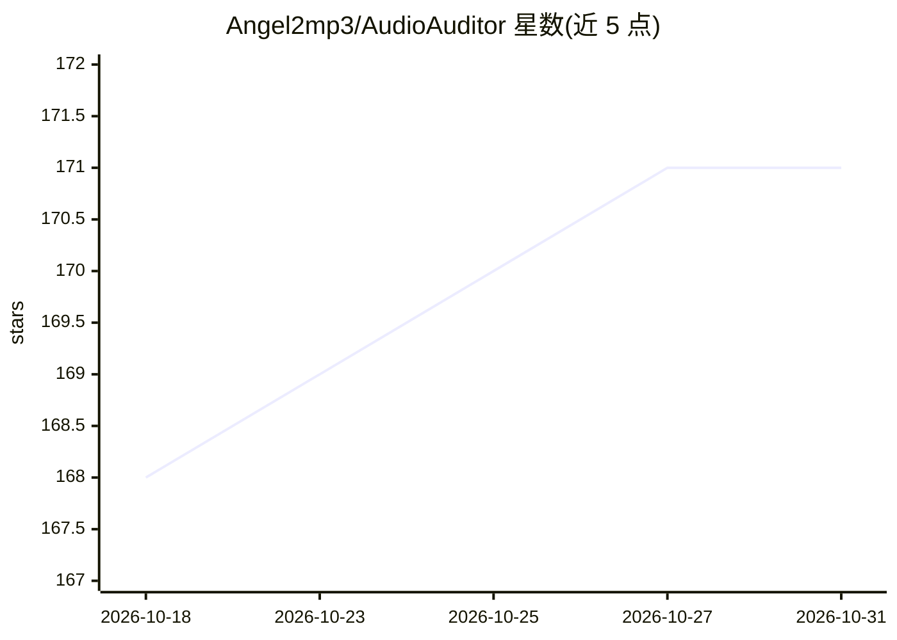

# Angel2mp3/AudioAuditor

⭐ 171 · C# · Apache-2.0 · 推送 2026-08-18 · [GitHub](https://github.com/Angel2mp3/AudioAuditor) · [官网](https://audioauditor.org/) · 个人维护

**音频质量审计与播放工具：检测假无损、AI 生成音频等**

基于 .NET 8 的音频分析应用（GUI 仅 Windows，CLI 支持 Windows/Linux），针对音频文件执行多种检测：假无损识别（FFT 频谱分析与有效频率上限）、数字削波、MQA 编码、AI 生成音频（元数据/C2PA 溯源标记/水印，覆盖 Suno、Udio 等 20 个服务）、BPM、True Peak、LUFS 响度等，并内置带参量均衡器、空间音频与同步歌词的播放器。托管解码器覆盖 FLAC/WAV/MP3 等格式，其余格式经外部 ffmpeg 进程解码。面向音频爱好者与音乐制作者。

## 筛选速览

| 维度 | 判定 | 备注 |
|---|---|---|
| AI 角色 | `ai-enhanced` | 去掉 AI 部分产品仍成立 |
| 许可风险 | `permissive` | Apache-2.0 |
| 部署形态 | `desktop` | 安装包/桌面程序 |
| 模型依赖 | — | README 未给出锁定关系 |
| 硬件要求 | — | 无带数字的原话,不猜 |
| 安装摩擦 | `medium` | 含编译或系统依赖之一 |
| 成熟度 | — | 结构信号不足 |

## 能力要点

- 假无损检测：4096 点 FFT 频谱分析判定有效频率上限
- AI 生成音频检测：元数据、C2PA 溯源标记、水印（AudioSeal/SynthID/WavMark），覆盖 20 个命名服务并给出置信评分
- 削波/MQA/BPM/True Peak/LUFS/假立体声等多项质量检测
- 内置播放器：10 段参量均衡器、空间音频、同步歌词、迷你播放器

## 适用场景

- 核验 FLAC 收藏是否为升采样假无损
- 检查音乐文件是否由 Suno/Udio 等 AI 服务生成
- 制作母带时检查削波与响度指标
- 日常听音与浏览曲库（内置播放器）

## 场景标签

 · 领域:音频处理/桌面工具

## 证据(README 行号)

> L47: **AudioAuditor** is a feature-rich audio analysis app for Windows that analyzes your audio files to detect **fake l
> L65: - **AI-Generated Audio Detection** — Scans metadata tags, raw byte patterns, and content provenance markers (C2PA) 

## 星数曲线

2026-10-18 168 → 2026-10-31 171（+3）

---
*卡片 v1 · prompt 1.4 · 生成 2026-10-22 · 置信度 high · 依据 README sha `5aa148f9c578` · [字段定义](../../DATASET.md)*
