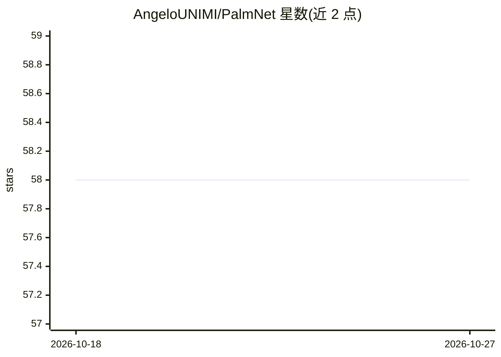

# AngeloUNIMI/PalmNet

⭐ 58 · Python · GPL-3.0 · 推送 2026-09-24 · [GitHub](https://github.com/AngeloUNIMI/PalmNet) · [官网](http://iebil.di.unimi.it/palmnet/index.htm) · 个人维护

**非接触掌纹识别研究代码：Gabor-PCA 卷积网络的 MATLAB 与 PyTorch 实现**

IEEE TIFS 2019 论文 PalmNet 的源码仓库，提供 MATLAB 原始实现与 Python/PyTorch 移植两套代码，面向非接触掌纹生物识别。方法组合 Gabor 滤波、PCA 卷积滤波学习、自适应方向分析与二值哈希块直方图特征，以 k-NN 完成验证与识别。Python 版支持 CPU/CUDA 执行、批处理卷积与稀疏特征存储，并复现 MATLAB 兼容的实验协议（identity-disjoint 折分、EER/FMR1000 指标）；输入需为已分割的掌纹 ROI。

## 筛选速览

| 维度 | 判定 | 备注 |
|---|---|---|
| AI 角色 | `ai-native` | 本体是模型或模型工具 |
| 许可风险 | `viral` | GPL-3.0 |
| 部署形态 | `library` | 以包/库形式分发 |
| 模型依赖 | — | README 未给出锁定关系 |
| 硬件要求 | `cpu-ok` | |
| 安装摩擦 | `medium` | 含编译或系统依赖之一 |
| 成熟度 | — | 结构信号不足 |

## 能力要点

- Gabor-PCA 卷积滤波 + 二值哈希块直方图特征与 k-NN 分类
- MATLAB 原始实现与 Python/PyTorch 移植双实现，含数值一致性验证工具
- 支持 CPU/CUDA、批处理 PCA/Gabor 与稀疏特征存储（约 1228 万维描述子）
- 提供 MATLAB 兼容实验协议与验证/识别指标（EER、FMR1000、留一 k-NN）

## 适用场景

- 复现 TIFS 2019 掌纹识别论文实验结果
- 在掌纹数据集（如 Tongji 非接触数据集）上做验证与识别实验
- 对比或扩展 Gabor-PCA 卷积特征提取方法

## 场景标签

`人脸识别` · 领域:感知与多模态

## 证据(README 行号)

> L17: **PalmNet** is a palmprint recognition pipeline designed for **touchless biometric acquisition**. The method combin
> L23: - **Verification and identification**

## 星数曲线

2026-10-18 58 → 2026-10-27 58（+0）

---
*卡片 v1 · prompt 1.4 · 生成 2026-10-24 · 置信度 high · 依据 README sha `d3c2afda7b07` · [字段定义](../../DATASET.md)*
