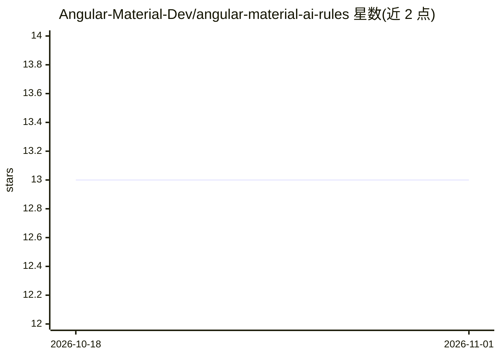

# Angular-Material-Dev/angular-material-ai-rules

⭐ 13 · MIT · 推送 2026-05-11 · [GitHub](https://github.com/Angular-Material-Dev/angular-material-ai-rules) · [官网](http://ui.angular-material.dev/docs/rules-files) · 组织维护

**供 AI 代码编辑器使用的 Angular Material 编码规则文件集**

为多种 AI 代码编辑器提供 Angular Material 开发规则、指令与指南文件集合：针对 Cursor、VS Code、Copilot 系列 IDE、Windsurf、JetBrains、Firebase Studio 分别提供 .mdc、.instructions.md、guidelines.md 等对应格式的规则文件，用户按各编辑器的自定义规则机制配置后生效。仓库本身不含代码运行时，仅提供规则文件内容。

## 筛选速览

| 维度 | 判定 | 备注 |
|---|---|---|
| AI 角色 | `ai-knowledge` | 知识聚合/清单类 |
| 许可风险 | `permissive` | MIT |
| 部署形态 | `None` |  |
| 模型依赖 | — | README 未给出锁定关系 |
| 硬件要求 | — | 无带数字的原话,不猜 |
| 安装摩擦 | `low` | 无编译、无系统依赖或容器化 |
| 成熟度 | — | 结构信号不足 |

## 能力要点

- 覆盖 6 种 AI 编辑器/IDE 的专用规则文件格式
- 针对各编辑器给出对应的配置方式说明
- 以 Angular Material 20 为规则基准版本

## 适用场景

- 让 Cursor/Copilot 等 AI 编辑器按 Angular Material 规范生成代码
- 团队统一下载并配置 AI 编辑器的项目编码规则

## 场景标签

`代码生成` `提示工程` · 领域:Agent 开发

## 证据(README 行号)

> L3: This repo contains rules, instructions and guidelines for various AI based code editors to work with Angular Materia
> L7: |Environment/IDE|Rules File|Installation Instructions|

## 星数曲线

2026-10-18 13 → 2026-11-01 13（+0）

---
*卡片 v1 · prompt 1.4 · 生成 2026-10-31 · 置信度 high · 依据 README sha `3e2877fec9c9` · [字段定义](../../DATASET.md)*
