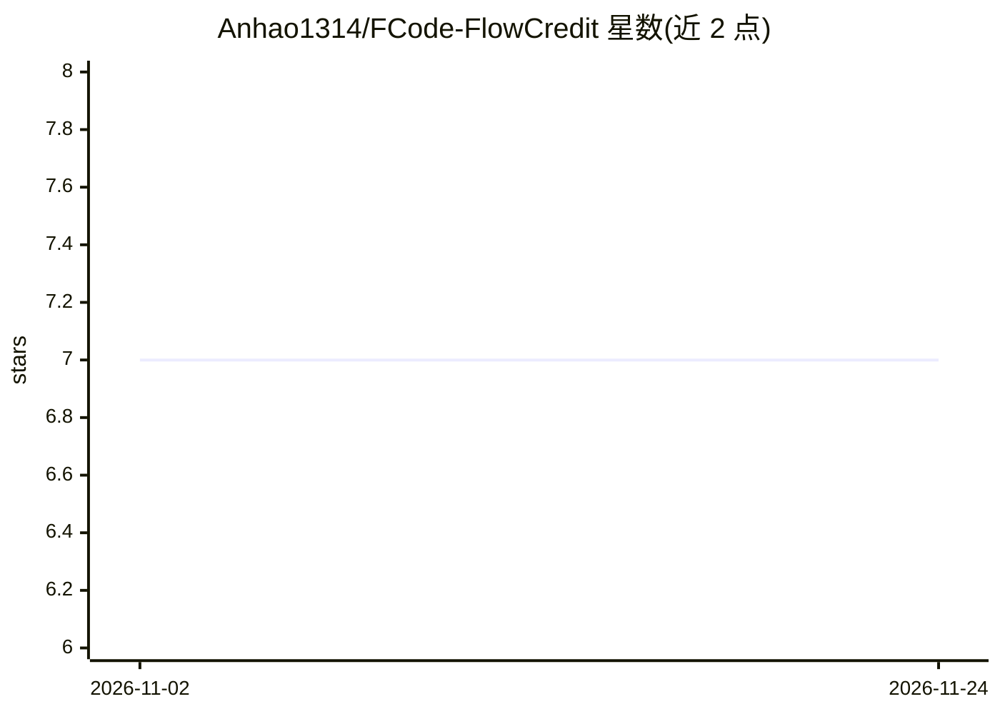

# Anhao1314/FCode-FlowCredit

⭐ 7 · Python · Apache-2.0 · 推送 2026-11-22 · [GitHub](https://github.com/Anhao1314/FCode-FlowCredit) · 个人维护 · 中文 README

**本地可审计的 Agent 运行时，审计其他 agent 应用**

FCode 是一个本地优先、可恢复、可审计的单 Agent Runtime：模型负责理解与提议，Runtime 负责计划、权限、预算、执行、验证与恢复，人保留关键决定权。核心机制包括 typed capability 阶段机、按产物字节推进的阶段门、有界 repair ticket、构图回滚与哈希链审计事件。附带审计域 flowaudit：按 AGI 九类漏洞分类法审计其他 agent 应用，PoC 可在受限子进程中重放。Python 3.11+ 运行，离线演示零第三方依赖；桌面构建目前验证过 macOS arm64。作者自称不是 Moonshot AI 官方产品。

## 筛选速览

| 维度 | 判定 | 备注 |
|---|---|---|
| AI 角色 | `ai-ecosystem` | LLM/agent 周边工具 |
| 许可风险 | `permissive` | Apache-2.0 |
| 部署形态 | `None` |  |
| 模型依赖 | — | README 未给出锁定关系 |
| 硬件要求 | — | 无带数字的原话,不猜 |
| 安装摩擦 | `low` | 无编译、无系统依赖或容器化 |
| 成熟度 | — | 结构信号不足 |

## 能力要点

- Runtime 负责权限、预算、执行、验证与恢复，人保留关键决定权
- typed capability 阶段门：按 artifact 字节推进，失败返回有界 repair ticket
- 审计域 flowaudit：AGI 九类漏洞分类法，发现附可重放 PoC，审计事件进哈希链
- 回归包含 1,406 项 Python 测试、418 项前端测试与 19 个版本化 Runtime 任务

## 适用场景

- 让 agent 在本地权限与预算护栏下执行代码与交付文件
- 审计其他 agent 应用的漏洞并重放 PoC 证据
- 对无源码的 .app / 二进制 / JS 树做制品级静态审计

## 场景标签

`模型评测` `网络安全` · 领域:评测与运维

## 证据(README 行号)

> L9:  一个本地优先、可恢复、可审计的 Agent Runtime。
> L19: FCode 把目标变成一段可检查的工作过程：模型负责理解与提议，Runtime 负责计划、权限、预算、执行、验证与恢复，人始终保留关键决定的控制权。
> L86: 同一个 Runtime 之上，FCode 还有审计域 `flowaudit`：审计其他 agent 应用，而不是只给它们打分。

## 星数曲线

2026-11-02 7 → 2026-11-24 7（+0）

---
*卡片 v1 · prompt 1.4 · 生成 2026-11-20 · 置信度 high · 依据 README sha `82be78119898` · [字段定义](../../DATASET.md)*
