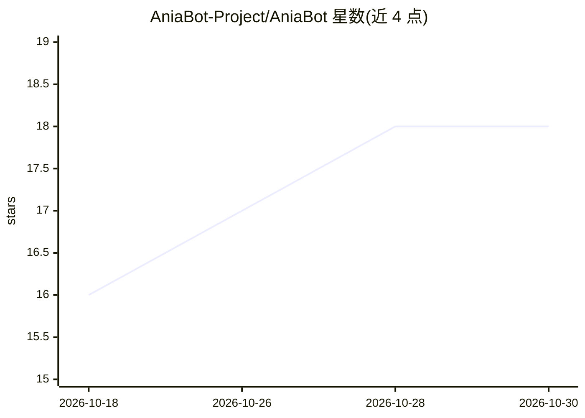

# AniaBot-Project/AniaBot

⭐ 18 · Go · MIT · 推送 2026-10-29 · [GitHub](https://github.com/AniaBot-Project/AniaBot) · [官网](https://aniabot-project.github.io/AniaBot/) · 组织维护 · 中文 README

**Go 语言插件驱动型多平台聊天机器人框架，内置 AI 对话插件**

基于 Go 开发的多平台机器人框架，通过适配器架构接入 QQ（NapCat/LLBot、OneBot v11）、飞书、Telegram、Discord、微信等平台，新增平台只需实现适配器并注册、核心零改动。功能以插件形式组织：内置 AI 对话（含 MCP/Skills/Tool Use）、复读机、每日新闻等插件，并设有可在线安装/升级/卸载的插件市场与 Web 控制面板（http://127.0.0.1:7700）。提供源码编译、二进制压缩包与 Docker 三种部署方式，面向想快速搭建并扩展聊天机器人的开发者。

## 筛选速览

| 维度 | 判定 | 备注 |
|---|---|---|
| AI 角色 | `ai-enhanced` | 去掉 AI 部分产品仍成立 |
| 许可风险 | `permissive` | MIT |
| 部署形态 | `self-host` | docker 或自建部署 |
| 模型依赖 | — | README 未给出锁定关系 |
| 硬件要求 | — | 无带数字的原话,不猜 |
| 安装摩擦 | `low` | 无编译、无系统依赖或容器化 |
| 成熟度 | — | 结构信号不足 |

## 能力要点

- 适配 QQ/飞书/Telegram/Discord/微信等多平台，适配器可扩展
- 内置 AI 对话插件，支持 MCP/Skills/Tool Use
- 插件市场支持在线安装/升级/卸载并自动编译重启
- 提供 Web 控制面板与二进制/Docker 部署，容器内置自动更新

## 适用场景

- 搭建同时接入多个聊天平台的机器人
- 通过插件市场安装第三方功能或提交自己的插件
- 为 QQ/微信等平台部署带 AI 对话能力的机器人

## 场景标签

`聊天机器人` · 领域:对话与助手

## 证据(README 行号)

> L3:  一个插件驱动型多平台机器人框架
> L14: - **多平台**：QQ（NapCat/LLBot WebSocket/HTTP，OneBot v11）+ 飞书（官方 SDK 长连接/Webhook）+ Telegram（Bot API 长轮询，无需公网地址）+ Discord
> L15: - **开箱即用**：内置 AI 对话（含 MCP/Skills/Tool Use）、复读机、每日新闻等插件

## 星数曲线

2026-10-18 16 → 2026-10-30 18（+2）

---
*卡片 v1 · prompt 1.4 · 生成 2026-10-29 · 置信度 high · 依据 README sha `4cc60dff8e25` · [字段定义](../../DATASET.md)*
