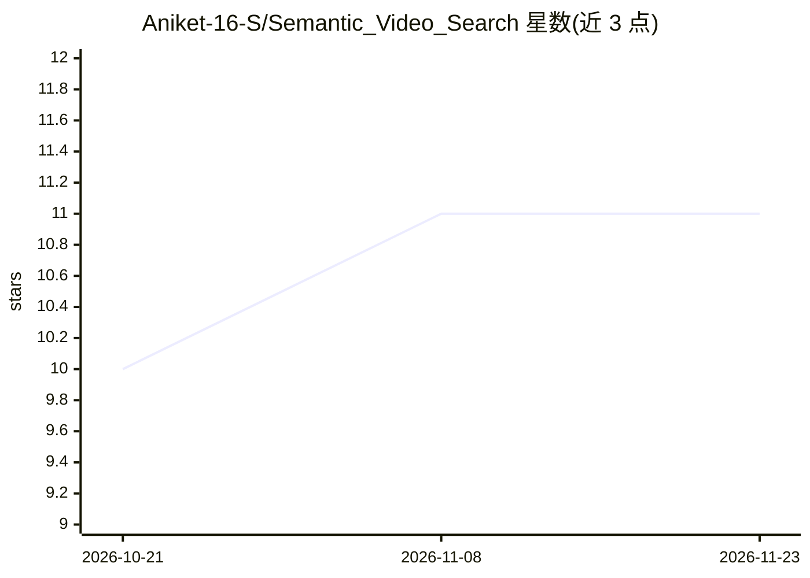

# Aniket-16-S/Semantic_Video_Search

⭐ 11 · Python · GPL-3.0 · 推送 2026-08-04 · [GitHub](https://github.com/Aniket-16-S/Semantic_Video_Search) · 个人维护

**用自然语言搜索视频内容的语义搜索引擎**

基于 Google SigLIP 的视频语义搜索引擎：上传视频后用 FFmpeg 单次解码抽帧并按场景变化过滤，ONNX Runtime 上运行 INT8 量化的 SigLIP 生成嵌入存入 Qdrant（MMAP 存储 + HNSW 索引 + INT8 标量量化），随后支持自然语言查询并返回匹配时间戳。后端为 FastAPI + 异步生产者-消费者流水线，全部推理在 CPU 上完成，无 GPU 依赖；提供 Docker Compose 一键部署与本地开发两种方式，GPL-3.0 许可。

## 筛选速览

| 维度 | 判定 | 备注 |
|---|---|---|
| AI 角色 | `ai-native` | 本体是模型或模型工具 |
| 许可风险 | `viral` | GPL-3.0 |
| 部署形态 | `self-host` | docker 或自建部署 |
| 模型依赖 | — | README 未给出锁定关系 |
| 硬件要求 | `cpu-ok` | |
| 安装摩擦 | `low` | 无编译、无系统依赖或容器化 |
| 成熟度 | — | 结构信号不足 |

## 能力要点

- SigLIP 嵌入 + Qdrant 向量库实现自然语言视频检索，返回匹配时间戳
- INT8 量化并拆分视觉/文本编码器（文本编码器约 26 MB），CPU 即可运行
- FFmpeg 场景变化抽帧过滤，据称吞吐较均匀采样提升约 6–8 倍
- Docker Compose 一键部署完整栈，含 REST API 与 Swagger 文档

## 适用场景

- 在长视频中用一句自然语言描述找到目标片段
- 为视频素材库建立可语义检索的索引
- 在无 GPU 的低配机器上跑视频语义搜索服务

## 场景标签

`语义搜索` `向量数据库` `图像视频处理` · 领域:知识与检索

## 证据(README 行号)

> L14: The system extracts semantic embeddings from video frames using **SigLIP**, stores them in **Qdrant**, and retrieve
> L122: |🖥️ Hardware Requirement|CPU Only|
> L257: * Fully CPU-compatible inference

## 星数曲线

2026-10-21 10 → 2026-11-23 11（+1）

---
*卡片 v1 · prompt 1.4 · 生成 2026-11-19 · 置信度 high · 依据 README sha `4b34809d077b` · [字段定义](../../DATASET.md)*
