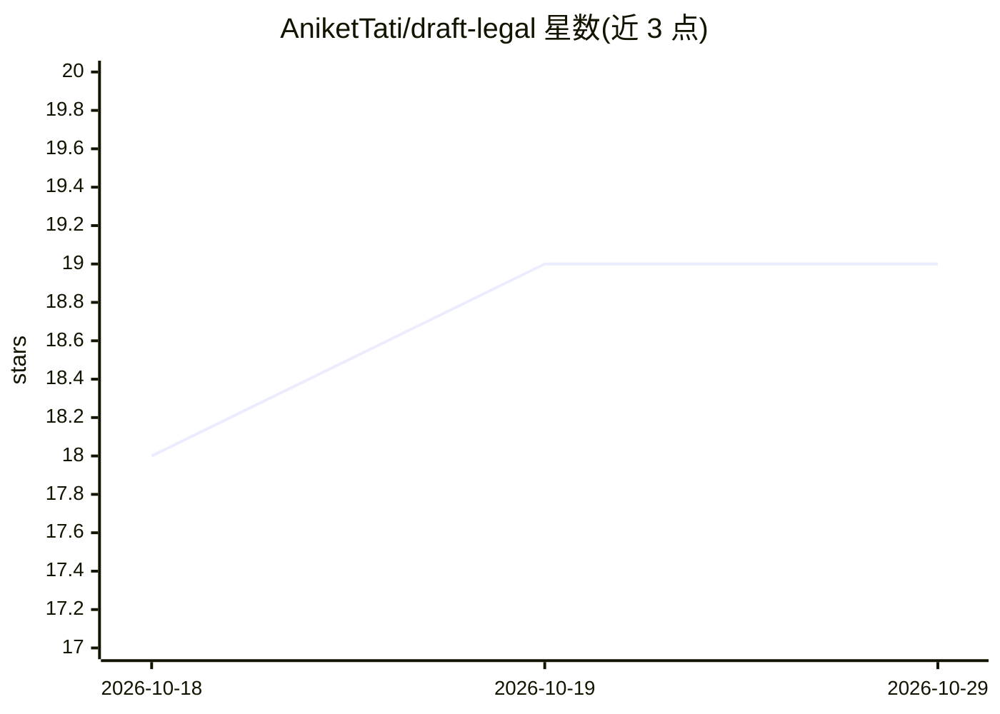

# AniketTati/draft-legal

⭐ 19 · TypeScript · NOASSERTION · 推送 2026-10-02 · [GitHub](https://github.com/AniketTati/draft-legal) · [官网](https://github.com/AniketTati/draft-legal) · 个人维护

**自托管 AI 合同全生命周期管理平台，面向企业法务**

开源、可自托管的合同生命周期管理（CLM）系统：覆盖起草、审查、红线修改、谈判、审批、电子签署与义务跟踪，各环节由 AI agent 驱动。提供带约 30 个工具的对话助手与 8 个专职 agent，对合同做条款提取、风险评分与溯源引用，并通过 pgvector+Elasticsearch 混合检索实现组合级问答。支持 Anthropic/OpenAI/Gemini 自带密钥接入；无 API key 时可浏览上传但不启用 AI 功能。本地运行需 Docker、Node 22+、pnpm 9+、Python 3.11+。

## 筛选速览

| 维度 | 判定 | 备注 |
|---|---|---|
| AI 角色 | `ai-native` | 本体是模型或模型工具 |
| 许可风险 | `none` | NOASSERTION |
| 部署形态 | `self-host` | docker 或自建部署 |
| 模型依赖 | — | README 未给出锁定关系 |
| 硬件要求 | — | 无带数字的原话,不猜 |
| 安装摩擦 | `low` | 无编译、无系统依赖或容器化 |
| 成熟度 | — | 结构信号不足 |

## 能力要点

- AI agent 覆盖起草/审查/红线/审批/签署/义务跟踪全流程
- 条款提取、风险评分并引用至条款与 PDF 页码
- pgvector+Elasticsearch+RRF 融合的组合级混合检索问答
- BYOK 支持 Anthropic/OpenAI/Gemini，自托管数据不出本地

## 适用场景

- 在企业自有服务器上管理合同全生命周期
- 向整个合同组合提问并获得有引用依据的回答
- 生成保守/温和/激进三档反提案红线文本

## 场景标签

`文档问答` `AI 写作` · 领域:内容生成

## 证据(README 行号)

> L4: **Self-hosted, AI-native contract lifecycle management — your contracts never leave your servers.**
> L20: **draftLegal does it all, open source, on your own servers:** draft, review, redline, negotiate, approve, e-sign, a
> L32: |🤖 **Agent-first**|A chat assistant with ~30 tools over *your* contracts — search, cite, compare, draft, redline, r

## 星数曲线

2026-10-18 18 → 2026-10-29 19（+1）

---
*卡片 v1 · prompt 1.4 · 生成 2026-10-29 · 置信度 mid · 依据 README sha `30bf4b2881aa` · [字段定义](../../DATASET.md)*
