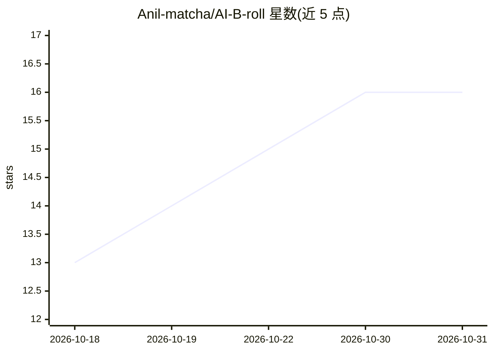

# Anil-matcha/AI-B-roll

⭐ 16 · Jupyter Notebook · MIT · 推送 2026-09-17 · [GitHub](https://github.com/Anil-matcha/AI-B-roll) · [官网](https://www.vadoo.tv/b-roll) · 个人维护

**用 AI 为视频生成 B-roll 素材的工具，依赖 MuAPI**

基于 MuAPI 的 B-roll 生成工具：为输入视频自动生成补充画面素材。README 内容简略，主要提供示例输出、视频教程链接与演示 GIF，并列出相关项目（视频生成 API 文档、YouTube Shorts 生成器、文生视频等）及多个付费视频工具的替代方案清单。仓库未展示具体的安装命令、运行方式或 API 使用细节，实现机制需查阅代码或外部文档确认。

## 筛选速览

| 维度 | 判定 | 备注 |
|---|---|---|
| AI 角色 | `ai-native` | 本体是模型或模型工具 |
| 许可风险 | `permissive` | MIT |
| 部署形态 | `None` |  |
| 模型依赖 | — | README 未给出锁定关系 |
| 硬件要求 | — | 无带数字的原话,不猜 |
| 安装摩擦 | `low` | 无编译、无系统依赖或容器化 |
| 成熟度 | — | 结构信号不足 |

## 能力要点

- 为视频生成 AI B-roll 素材，由 MuAPI 提供支持
- 提供示例输出与视频教程
- 关联多个视频 AI 项目（YouTube Shorts 生成器、文生视频等）

## 适用场景

- 为已有视频自动补充 B-roll 画面
- 批量制作短视频时生成辅助素材

## 场景标签

`视频生成` · 领域:内容生成

## 证据(README 行号)

> L3: Powered by MuAPI
> L5: Generate broll for a video using AI

## 星数曲线

2026-10-18 13 → 2026-10-31 16（+3）

---
*卡片 v1 · prompt 1.4 · 生成 2026-10-30 · 置信度 low · 依据 README sha `91453cd1fc8c` · [字段定义](../../DATASET.md)*
