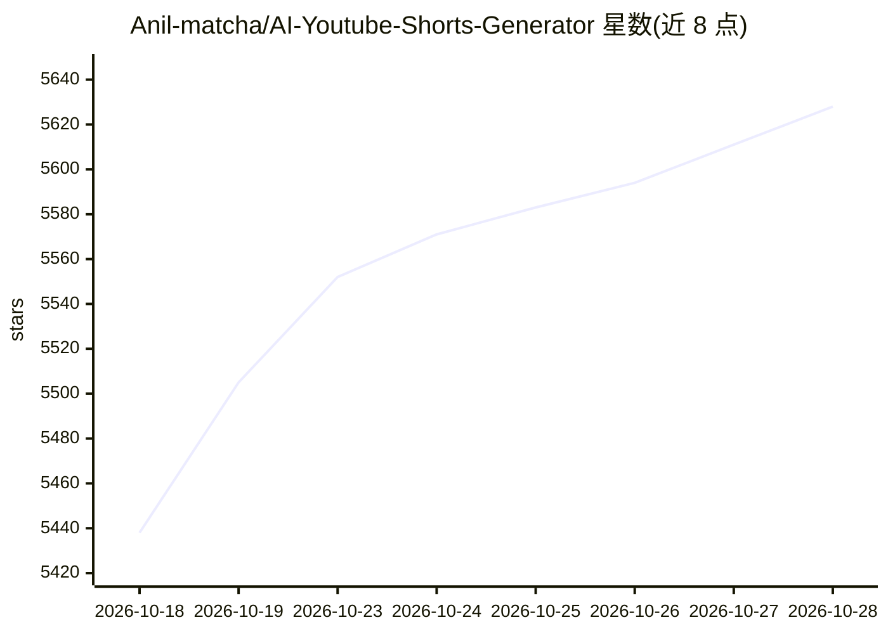

# Anil-matcha/AI-Youtube-Shorts-Generator

⭐ 5,641 · Python · MIT · 推送 2026-10-24 · [GitHub](https://github.com/Anil-matcha/AI-Youtube-Shorts-Generator) · [官网](https://www.vadoo.tv/ai-youtube-shorts-generator) · 个人维护

**将长视频自动切成竖版短视频的 CLI/库，LLM 选段+Whisper 转录**

输入 YouTube URL 或本地视频文件，经下载、Whisper 转录、LLM 按传播力框架（钩子、情绪峰值、观点冲突等）对候选片段打分排序、去重后，自动竖版裁剪并渲染为 9:16 等比例的 mp4 短视频，附标题、评分与理由。提供 CLI 与 Python 库两种用法，支持 JSON 输出与批处理。两种运行模式：默认 API 模式依赖 MuAPI；本地模式用 yt-dlp、faster-whisper、ffmpeg/OpenCV，LLM 步骤仍需 OpenAI 或 Gemini key。MIT 许可。

## 筛选速览

| 维度 | 判定 | 备注 |
|---|---|---|
| AI 角色 | `ai-native` | 本体是模型或模型工具 |
| 许可风险 | `permissive` | MIT |
| 部署形态 | `library` | 以包/库形式分发 |
| 模型依赖 | — | README 未给出锁定关系 |
| 硬件要求 | — | 无带数字的原话,不猜 |
| 安装摩擦 | `medium` | 含编译或系统依赖之一 |
| 成熟度 | — | 结构信号不足 |

## 能力要点

- LLM 按传播力框架对候选片段打分（0-100）并附钩子句与理由
- 双模式：MuAPI 一站式 API 或本地 yt-dlp+faster-whisper+ffmpeg 流水线
- OpenCV 人脸跟踪+运动平滑的竖版自动裁剪
- 长视频自动分块（>30 分钟按 20 分钟重叠切分）与重叠候选去重

## 适用场景

- 把播客/访谈等长视频批量切成 TikTok/Reels/Shorts 竖版片段
- 自建短视频剪辑流水线时作为 Python 库导入并输出 JSON
- 离线处理本地视频文件（仅 LLM 排序步骤需联网）

## 场景标签

`图像视频处理` · 领域:感知与多模态

## 证据(README 行号)

> L7: Built for creators, agencies, and developers who don't want to pay $20–$300/month or be capped on minutes processed.
> L40: - **🔀 Two Modes — API (fast) or Local (offline)**: Default `--mode api` uses MuAPI for download/transcription/cropp

## 星数曲线

2026-10-18 5,438 → 2026-10-28 5,628（+190）

---
*卡片 v1 · prompt 1.4 · 生成 2026-10-20 · 置信度 high · 依据 README sha `881e97c7da26` · [字段定义](../../DATASET.md)*
