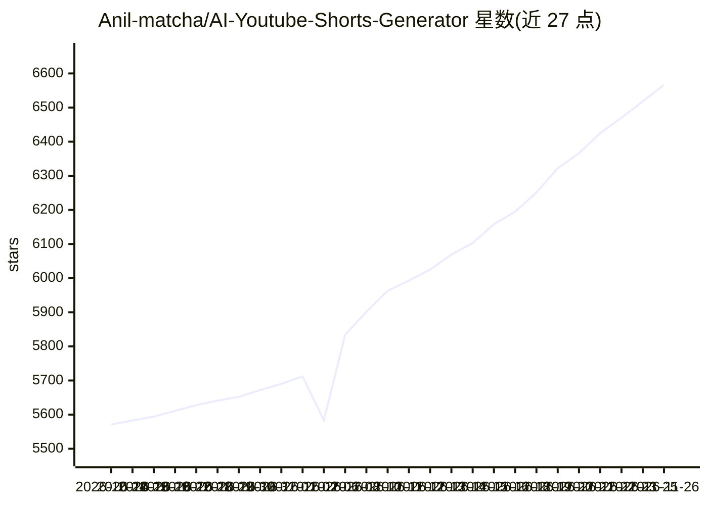

# Anil-matcha/AI-Youtube-Shorts-Generator

⭐ 6,567 · Python · MIT · 推送 2026-11-24 · [GitHub](https://github.com/Anil-matcha/AI-Youtube-Shorts-Generator) · [官网](https://www.vadoo.tv/ai-youtube-shorts-generator) · 个人维护

**面向创作者的长视频转 9:16 短视频开源生成工具**

将长 YouTube 视频处理为竖屏短视频：下载源视频，用 Whisper 类转录生成带时间戳文本，LLM 按传播度框架（钩子、情绪峰值、冲突、金句等）对片段打分排序，再自动裁切为 9:16 等16:9 以外的比例输出 mp4。提供 API 模式（MuAPI 一站式处理）与本地模式（yt-dlp/faster-whisper/ffmpeg/OpenCV，仅 LLM 调用远程）两种运行方式，超过 30 分钟的视频自动分块，重叠候选按分数去重。提供 CLI 与 Python 库接口，MIT 许可，可自托管，输出 JSON 结果供下游自动化。

## 筛选速览

| 维度 | 判定 | 备注 |
|---|---|---|
| AI 角色 | `ai-native` | 本体是模型或模型工具 |
| 许可风险 | `permissive` | MIT |
| 部署形态 | `library` | 以包/库形式分发 |
| 模型依赖 | — | README 未给出锁定关系 |
| 硬件要求 | — | 无带数字的原话,不猜 |
| 安装摩擦 | `medium` | 含编译或系统依赖之一 |
| 成熟度 | — | 结构信号不足 |

## 能力要点

- LLM 传播度框架打分：每条片段附带分数、hook 句与理由
- API/本地双模式：本地模式用 faster-whisper（CPU/CUDA）与 OpenCV 人脸跟踪裁切
- 长视频自动分块（>30 分钟）与重叠候选去重
- CLI 与 Python 库双接口，--output-json 输出全量结果

## 适用场景

- 把播客/访谈长视频批量切成分发用的竖屏短视频
- 按 --aspect-ratio 输出 TikTok/Reels/Shorts 或任意比例片段
- 用自己的传播度标准改编 highlights.py 的打分框架
- 通过 JSON 输出把剪辑结果接入自动化流水线

## 场景标签

`图像视频处理` · 领域:感知与多模态

## 证据(README 行号)

> L5: **The open-source alternative to Opus Clip, Vidyo.ai, Klap, SubMagic, 2short.ai, and other AI clipping tools.** Drop
> L40: - **🔀 Two Modes — API (fast) or Local (offline)**: Default `--mode api` uses MuAPI for download/transcription/cropp
> L185: 1. **Download**: Fetches the source video from YouTube

## 星数曲线

2026-10-24 5,571 → 2026-11-26 6,567（+996）

---
*卡片 v1 · prompt 1.4 · 生成 2026-11-26 · 置信度 high · 依据 README sha `8d709ceecb70` · [字段定义](../../DATASET.md)*
