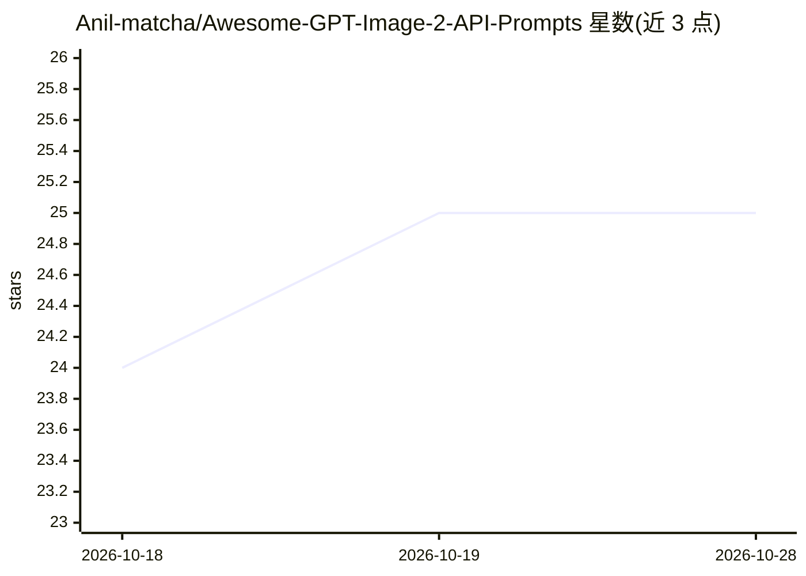

# Anil-matcha/Awesome-GPT-Image-2-API-Prompts

⭐ 25 · 推送 2026-10-01 · [GitHub](https://github.com/Anil-matcha/Awesome-GPT-Image-2-API-Prompts) · [官网](https://muapi.ai) · 个人维护

**GPT-Image-2 提示词策展清单：人像/海报/插画等即用提示词**

面向使用 OpenAI Images API（模型 gpt-image-2）的开发者与创作者的提示词合集，按人像摄影、海报插画等类别组织，每条提示词附来源作者；README 给出 OpenAI Python SDK 调用示例，说明所有提示词均可直接用于 API。仓库同时推广 MuAPI 托管 API 及其配套工具链（playground、CLI、agent skills、SaaS 模板）作为关联项目。内容为静态提示词列表，不含可运行代码或安装流程。

## 筛选速览

| 维度 | 判定 | 备注 |
|---|---|---|
| AI 角色 | `ai-knowledge` | 知识聚合/清单类 |
| 许可风险 | `none` | — |
| 部署形态 | `None` |  |
| 模型依赖 | — | README 未给出锁定关系 |
| 硬件要求 | — | 无带数字的原话,不猜 |
| 安装摩擦 | `low` | 无编译、无系统依赖或容器化 |
| 成熟度 | — | 结构信号不足 |

## 能力要点

- 分类组织的 gpt-image-2 即用提示词，每条附来源作者
- 提供 OpenAI Images API 的 Python 调用示例
- 覆盖人像摄影、海报、插画等多种图像生成场景

## 适用场景

- 开发图像生成应用时查找现成的高质量提示词
- 学习 gpt-image-2 的提示词写法与模式
- 快速试验 OpenAI Images API 不同风格输出

## 场景标签

`精选清单` `提示工程` · 领域:Agent 开发

## 证据(README 行号)

> L7: A curated collection of high-quality prompts and output examples for **GPT-Image-2** via the OpenAI API. This reposi
> L15: > **API Usage:** All prompts work with the OpenAI Images API using model `gpt-image-2`.

## 星数曲线

2026-10-18 24 → 2026-10-28 25（+1）

---
*卡片 v1 · prompt 1.4 · 生成 2026-10-27 · 置信度 high · 依据 README sha `7c1009941b8e` · [字段定义](../../DATASET.md)*
