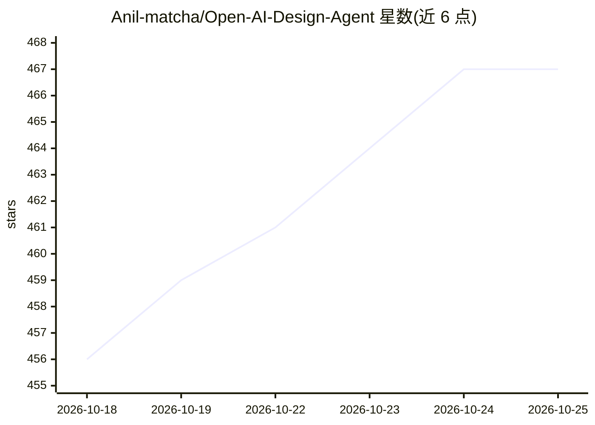

# Anil-matcha/Open-AI-Design-Agent

⭐ 467 · JavaScript · MIT · 推送 2026-10-01 · [GitHub](https://github.com/Anil-matcha/Open-AI-Design-Agent) · [官网](https://muapi.ai/assistant?utm_source=github&utm_medium=about&utm_campaign=open-ai-design-agent) · 组织维护

**开源 AI 设计 Agent：自然语言生成海报、品牌套件与视频**

MIT 许可的自托管 AI 设计 Agent，将自然语言简报转化为完整创意交付物。Agent 拆解简报为交付清单，按资产类型从 200+ 图像与视频模型中选路（Ideogram、Flux、Recraft、Kling、Sora、Veo 等，经 Muapi.ai API 网关），按依赖顺序生成并组装成套。支持多图参考（最多 14 张）、品牌套件持久化、编辑模式、矢量导出与 4K 放大、节点式 Workflow Studio。需自备 Muapi API key（有免费层），依赖 Node.js 18+ 与 Python 3.10+，提供 Docker Compose 部署。

## 筛选速览

| 维度 | 判定 | 备注 |
|---|---|---|
| AI 角色 | `ai-native` | 本体是模型或模型工具 |
| 许可风险 | `permissive` | MIT |
| 部署形态 | `self-host` | docker 或自建部署 |
| 模型依赖 | — | README 未给出锁定关系 |
| 硬件要求 | — | 无带数字的原话,不猜 |
| 安装摩擦 | `low` | 无编译、无系统依赖或容器化 |
| 成熟度 | — | 结构信号不足 |

## 能力要点

- Agent 自动规划→按资产选模型→依赖顺序生成→组装交付套件
- 200+ 图像与视频模型经 Muapi.ai 网关编排
- 品牌套件（配色/字体/logo）跨生成持久生效
- 最多 14 张参考图用于风格迁移与一致性

## 适用场景

- 用一句话简报产出完整品牌套件与发布物料
- 生成社交媒体帖、YouTube 缩略图与 9:16 视频广告
- 用节点式编辑器搭建可复用的设计流水线

## 场景标签

`图像生成` `视频生成` · 领域:内容生成

## 证据(README 行号)

> L5: > **The free, open-source AI design agent.** Plan, generate, and assemble full creative deliverables — posters, soci
> L39: Open AI Design Agent is a free, open-source AI design agent that turns natural-language briefs into full creative d

## 星数曲线

2026-10-18 456 → 2026-10-25 467（+11）

---
*卡片 v1 · prompt 1.4 · 生成 2026-10-21 · 置信度 high · 依据 README sha `044a0cecd7a7` · [字段定义](../../DATASET.md)*
