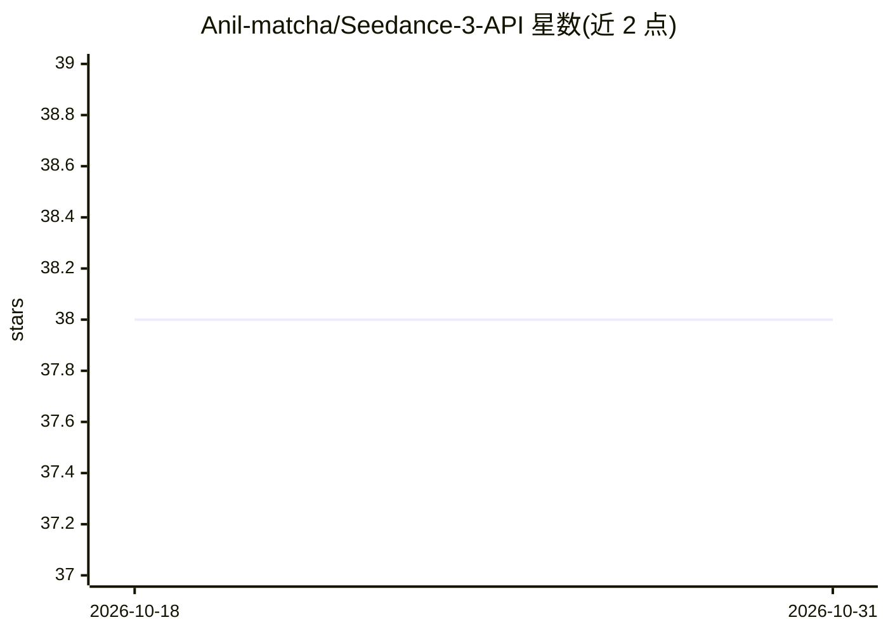

# Anil-matcha/Seedance-3-API

⭐ 38 · MIT · 推送 2026-10-06 · [GitHub](https://github.com/Anil-matcha/Seedance-3-API) · 个人维护

**面向开发者的 Seedance 3 视频生成 API SDK 与指南项目**

围绕 MuAPI 的 Seedance 3 AI 视频生成接口的 Python SDK 与开发者指南项目，工作流沿用 Seedance-2-API。计划提供文本生视频、图生视频、参考媒体引导生成、异步任务提交与轮询，以及 Python SDK 和 MCP 接入方式。README 声明 SDK 与 API 参考正在准备中，尚未落地，当前仅给出 git clone 的安装方式；Seedance 2.x 用户被指向已有的 Seedance-2-API 项目。

## 筛选速览

| 维度 | 判定 | 备注 |
|---|---|---|
| AI 角色 | `ai-ecosystem` | LLM/agent 周边工具 |
| 许可风险 | `permissive` | MIT |
| 部署形态 | `None` |  |
| 模型依赖 | — | README 未给出锁定关系 |
| 硬件要求 | — | 无带数字的原话,不猜 |
| 安装摩擦 | `low` | 无编译、无系统依赖或容器化 |
| 成熟度 | `idea` | |

## 能力要点

- 计划支持文本生视频、图生视频与参考媒体引导生成
- 异步生成流程：提交任务、轮询、取回结果
- 规划 Python SDK 与 MCP 供脚本和 AI 助手调用

## 适用场景

- 通过 MuAPI 接入 Seedance 3 视频生成能力
- 在脚本或 AI 助手中调用 MCP 生成视频
- 跟踪 Seedance 3 集成的开发者文档与示例进展

## 场景标签

`视频生成` · 领域:内容生成

## 证据(README 行号)

> L7: Seedance 3 API project for video generation through MuAPI, following the simple workflow of Seedance-2-API.
> L23: The SDK and API guide are being prepared for the Seedance 3 integration. The planned developer surface follows the 
> L29: - **Python SDK and MCP** — use generation from scripts and AI assistants

## 星数曲线

2026-10-18 38 → 2026-10-31 38（+0）

---
*卡片 v1 · prompt 1.4 · 生成 2026-10-25 · 置信度 mid · 依据 README sha `0f865c5475a1` · [字段定义](../../DATASET.md)*
