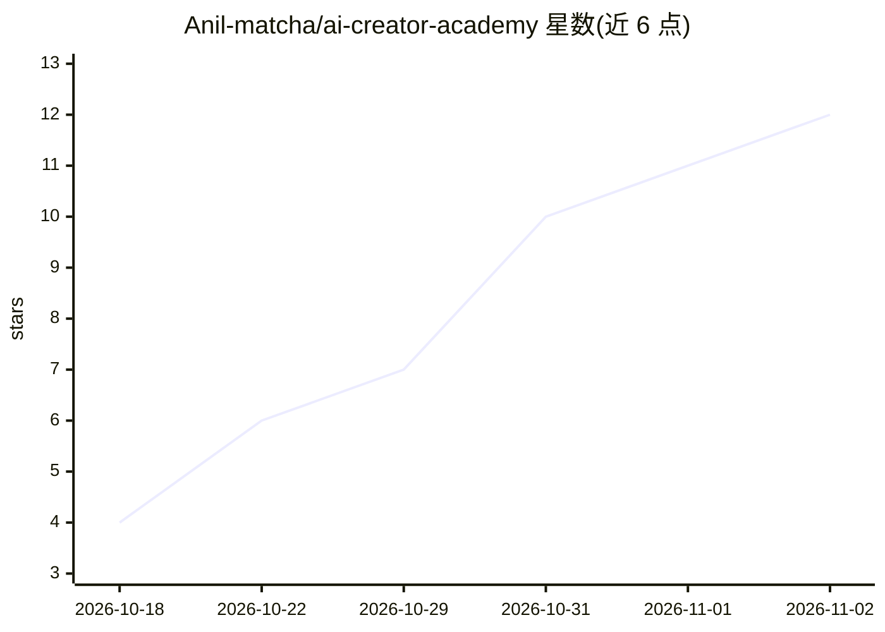

# Anil-matcha/ai-creator-academy

⭐ 12 · MIT · 推送 2026-10-15 · [GitHub](https://github.com/Anil-matcha/ai-creator-academy) · 个人维护

**教创作者用生成式 AI 做图/视频/音频变现的开源课程**

MIT 许可的免费开源课程，面向创作者与代理机构，主题是将 AI 生成的图像、视频、音频做成可定价出售的服务或产品。共规划 15 条独立路径、64 个模块，每模块遵循 Problem→Concept→Do It→Compare Tools→Launch It 结构，结尾含定价与获客内容；目前仅 Track 1（AI 视频广告与 UGC）完整写成。不要求编程，可用任意生成媒体 API（以 muapi.ai 为参考实现）或本地/自托管方案（如 ComfyUI）。获取方式为在线阅读或 git clone。

## 筛选速览

| 维度 | 判定 | 备注 |
|---|---|---|
| AI 角色 | `ai-knowledge` | 知识聚合/清单类 |
| 许可风险 | `permissive` | MIT |
| 部署形态 | `None` |  |
| 模型依赖 | — | README 未给出锁定关系 |
| 硬件要求 | — | 无带数字的原话,不猜 |
| 安装摩擦 | `low` | 无编译、无系统依赖或容器化 |
| 成熟度 | `idea` | |

## 能力要点

- 15 条路径规划，每模块含定价、定位与获客环节
- 模块结构固定：Problem→Concept→Do It→Compare Tools→Launch It
- Compare Tools 比较调用 API 与本地/自托管两条路径
- 模板工件存于各 track 的 templates/ 目录

## 适用场景

- 学习把 AI 生成内容做成可售卖的服务或产品
- 按兴趣选学某条路径（如 AI 头像、AI 音乐、按需印制）
- 了解 UGC 广告等细分市场的真实定价区间

## 场景标签

`教程课程` · 领域:学习与行业

## 证据(README 行号)

> L8:  Free, open-source curriculum for making money with generative AI image, video, and audio — for creators and agencie
> L16: Most AI education either teaches you to prompt a tool, or teaches you to build one. This teaches something else: ho
> L33: 15 independent tracks — pick whichever matches the business you want to build, in any order. Numbered by demand evi

## 星数曲线

2026-10-18 4 → 2026-11-02 12（+8）

---
*卡片 v1 · prompt 1.4 · 生成 2026-11-02 · 置信度 high · 依据 README sha `a6fd7eaba611` · [字段定义](../../DATASET.md)*
