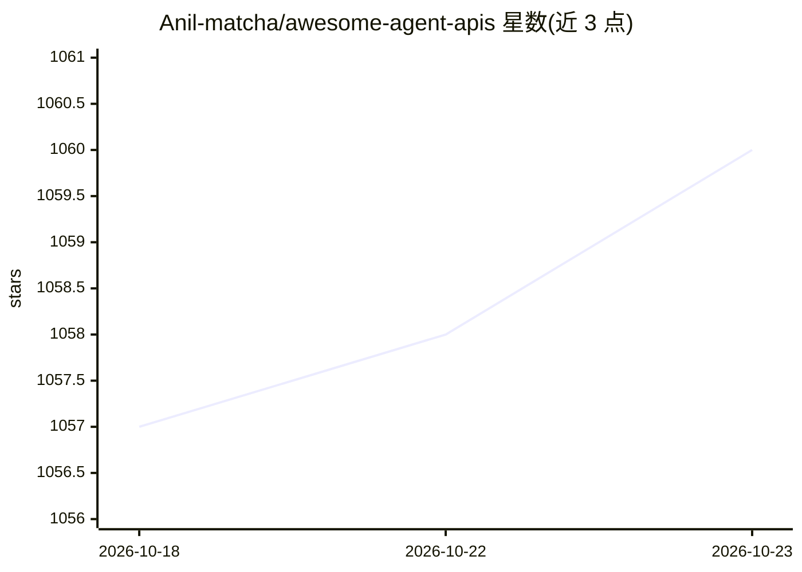

# Anil-matcha/awesome-agent-apis

⭐ 1,060 · Python · MIT · 推送 2026-10-14 · [GitHub](https://github.com/Anil-matcha/awesome-agent-apis) · [官网](https://muapi.ai/agent-skills) · 组织维护

**面向 agent 的 API 工具目录：660+ 生成媒体模型与第三方工具**

一个 YAML 条目式 API 目录仓库：收录 muapi 托管的 660+ 生成媒体模型（models/，自动同步）与社区经 PR 提交的第三方 API 工具（providers/，覆盖 SEO、数据富化、社媒、抓取等），每条记录 base_url、认证方式、端点、真实定价与示例响应。仓库本身是参考目录而非代理，调用需使用自己的 key；提供 capabilities.yaml 分类浏览、llms.txt 供 agent 一次读取、本地校验脚本与 draft/verified/live 状态标记。

## 筛选速览

| 维度 | 判定 | 备注 |
|---|---|---|
| AI 角色 | `ai-knowledge` | 知识聚合/清单类 |
| 许可风险 | `permissive` | MIT |
| 部署形态 | `None` |  |
| 模型依赖 | — | README 未给出锁定关系 |
| 硬件要求 | — | 无带数字的原话,不猜 |
| 安装摩擦 | `low` | 无编译、无系统依赖或容器化 |
| 成熟度 | — | 结构信号不足 |

## 能力要点

- 660+ muapi 托管生成媒体模型条目自动同步
- 第三方工具经 PR 提交并维护者实测验证（verified 状态含真实响应示例）
- 每条 YAML 记录认证方式、真实定价与捕获的示例响应
- 提供 llms.txt 供 agent 一次获取浏览与使用方式，无需安装或认证

## 适用场景

- 为 agent 查找可调用的第三方 API 工具及其定价与认证细节
- 在订阅付费工具前预览实际调用成本与返回格式
- 通过 PR 收录自己使用的 API 工具到公开目录

## 场景标签

`精选清单` · 领域:学习与行业

## 证据(README 行号)

> L6: A catalog of API tools an agent can call — 660+ generative-media models available
> L11: This is a **reference catalog, not a live proxy**. Every entry is documentation —
> L16: **Agents:** read `llms.txt` — one fetch teaches you how to browse and

## 星数曲线

2026-10-18 1,057 → 2026-10-23 1,060（+3）

---
*卡片 v1 · prompt 1.4 · 生成 2026-10-21 · 置信度 high · 依据 README sha `7dfb5a08322b` · [字段定义](../../DATASET.md)*
