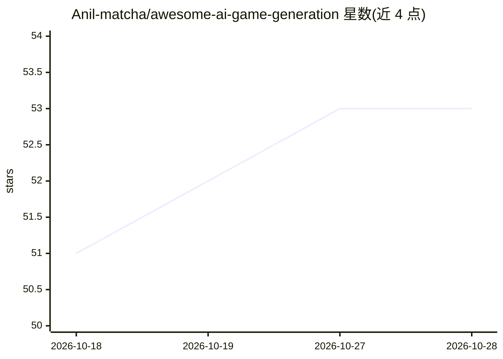

# Anil-matcha/awesome-ai-game-generation

⭐ 53 · NOASSERTION · 推送 2026-09-02 · [GitHub](https://github.com/Anil-matcha/awesome-ai-game-generation) · 个人维护

**AI 游戏生成工具与研究策展清单（世界模型到资产生成）**

一份 awesome 类策展清单，收录用 AI 生成游戏的工具、模型、研究与公司资源，覆盖范围从 LLM 辅助资产/代码脚手架到逐帧生成可玩世界的实时神经世界模型。条目按世界模型、prompt 生成游戏平台、2D/3D 资产生成器、AI NPC 对话系统、游戏音频、引擎 AI 集成、PCG、数据集、论文、公司与学习资源分类组织，并附全游戏生成平台对比表（Rosebud AI、Summer Engine、the9bit、Ludo.ai）与术语表。内容基于 2026 年中公开信息，采用 CC0 公共领域许可，欢迎 PR 更正。

## 筛选速览

| 维度 | 判定 | 备注 |
|---|---|---|
| AI 角色 | `ai-knowledge` | 知识聚合/清单类 |
| 许可风险 | `none` | NOASSERTION |
| 部署形态 | `None` |  |
| 模型依赖 | — | README 未给出锁定关系 |
| 硬件要求 | — | 无带数字的原话,不猜 |
| 安装摩擦 | `low` | 无编译、无系统依赖或容器化 |
| 成熟度 | — | 结构信号不足 |

## 能力要点

- 收录 Genie 3、GameNGen、Oasis 等实时世界模型条目
- 覆盖 prompt 生成游戏平台、资产生成器、NPC 对话、音频、引擎集成等类别
- 附全游戏生成平台对比表与术语表

## 适用场景

- 查找 prompt 生成游戏平台与世界模型研究资源
- 比较 Rosebud AI、Summer Engine 等全游戏生成平台
- 了解 AI NPC 对话、资产生成、音频等游戏 AI 工具生态

## 场景标签

`精选清单` · 领域:学习与行业

## 证据(README 行号)

> L3: > A curated list of tools, models, research, companies, and resources for generating games with AI — from prompt-to-
> L5: AI game generation spans a wide spectrum: LLM-assisted asset and code scaffolding on one end, and full **world model

## 星数曲线

2026-10-18 51 → 2026-10-28 53（+2）

---
*卡片 v1 · prompt 1.4 · 生成 2026-10-24 · 置信度 high · 依据 README sha `af9964a58201` · [字段定义](../../DATASET.md)*
