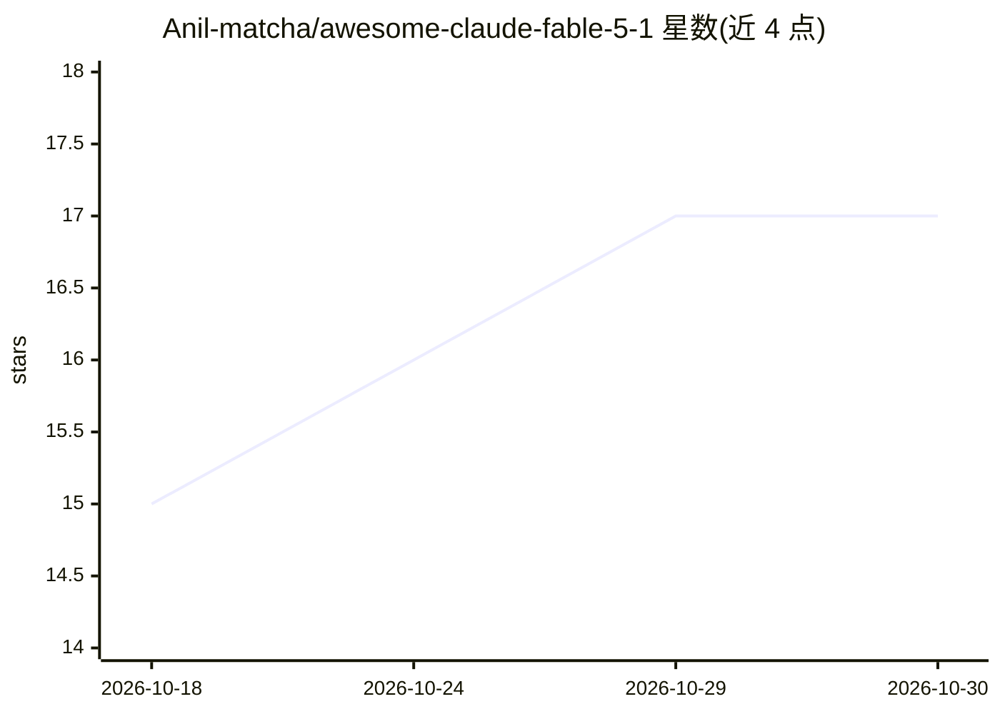

# Anil-matcha/awesome-claude-fable-5-1

⭐ 17 · MIT · 推送 2026-10-28 · [GitHub](https://github.com/Anil-matcha/awesome-claude-fable-5-1) · 组织维护

**Claude Fable 5.1 用例策展清单：104 条案例与迁移/定价证据**

围绕 Claude Fable 5.1 模型的策展式用例仓库：收录 10 条 5.1 当前案例与 94 条明确标注为 Fable 5 的基线存档，覆盖编码、长程自动化、游戏、视觉 3D、知识工作、教程与平台集成等类别；每条案例链接回原始出处，并汇总模型 ID、1M 上下文、定价、迁移注意事项与各平台可用性（Claude API、Bedrock、Google Cloud）。MuAPI 接入标注为'即将推出'。面向希望查找可复现提示词与升级路径证据的开发者。

## 筛选速览

| 维度 | 判定 | 备注 |
|---|---|---|
| AI 角色 | `ai-knowledge` | 知识聚合/清单类 |
| 许可风险 | `permissive` | MIT |
| 部署形态 | `library` | 以包/库形式分发 |
| 模型依赖 | locked-api |  |
| 硬件要求 | — | 无带数字的原话,不猜 |
| 安装摩擦 | `medium` | 含编译或系统依赖之一 |
| 成熟度 | — | 结构信号不足 |

## 能力要点

- 10 条 5.1 当前案例 + 94 条明确标注的 Fable 5 基线存档
- 汇总模型 ID、定价（$10/$50 per MTok）与迁移注意事项
- 每条案例链接原始来源，社区报告与官方声明分别标注
- 覆盖编码、自动化、游戏、3D、知识工作、集成等类别

## 适用场景

- 查找 Claude Fable 5.1 的可复现提示词与工作流
- 评估从 Fable 5 升级到 5.1 的迁移影响与 API 行为变化
- 了解模型在各平台的可用性与定价证据

## 场景标签

`精选清单` `提示工程` · 领域:Agent 开发

## 证据(README 行号)

> L28: **We collect real-world usage cases, tutorials, integrations, migration notes, and evaluations for Claude Fable 5.1
> L49: - **10 current Claude Fable 5.1 cases** covering the launch, API migration, prompting, benchmarks, research, safegu

## 星数曲线

2026-10-18 15 → 2026-10-30 17（+2）

---
*卡片 v1 · prompt 1.4 · 生成 2026-10-30 · 置信度 high · 依据 README sha `11d6862d2a6a` · [字段定义](../../DATASET.md)*
