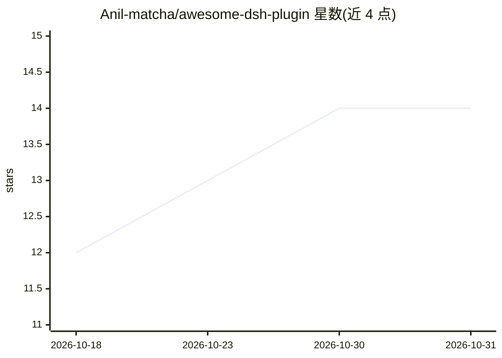

# Anil-matcha/awesome-dsh-plugin

⭐ 14 · Python · 推送 2026-09-17 · [GitHub](https://github.com/Anil-matcha/awesome-dsh-plugin) · 个人维护 · 中文 README

**DeepSeek Harness 社区插件策展清单，按类别一行一述**

围绕 DeepSeek 开源编码代理框架 dsh（一切皆插件的 Cordis 运行时）整理的社区插件清单：收录据称超千个插件，按 UI 增强、用量与计费、主题外观等类别组织，每个条目以一句话说明插件功能。README 同时介绍 dsh 的插件机制（dsh.bundle 清单、dsh plugin add 安装）、Web UI 与源码两种启动方式，并提示第三方插件以本机权限运行代码、收录不等于安全审计。

## 筛选速览

| 维度 | 判定 | 备注 |
|---|---|---|
| AI 角色 | `ai-knowledge` | 知识聚合/清单类 |
| 许可风险 | `none` | — |
| 部署形态 | `library` | 以包/库形式分发 |
| 模型依赖 | — | README 未给出锁定关系 |
| 硬件要求 | — | 无带数字的原话,不猜 |
| 安装摩擦 | `low` | 无编译、无系统依赖或容器化 |
| 成熟度 | — | 结构信号不足 |

## 能力要点

- 按 UI 增强/计费/主题等类别组织的插件目录
- 说明 dsh 插件机制与 dsh plugin add 安装命令
- 明确安全警告：插件以本机权限运行，收录非安全审查

## 适用场景

- 为 DeepSeek Harness 查找并比较社区插件
- 了解 dsh 插件生态的类别覆盖与功能
- 把自己的插件仓库打上 dsh-plugin topic 以便被发现

## 场景标签

`精选清单` · 领域:学习与行业

## 证据(README 行号)

> L3: > A curated guide to DeepSeek Harness (`dsh`) — DeepSeek's open-source, everything-is-a-plugin coding agent — and th
> L5: DeepSeek Harness is a runnable coding agent (Web UI + headless) built on Cordis, where every part of the system — mo
> L35: ## Plugin Categories

## 星数曲线

2026-10-18 12 → 2026-10-31 14（+2）

---
*卡片 v1 · prompt 1.4 · 生成 2026-10-31 · 置信度 mid · 依据 README sha `5f3bb6f78c57` · [字段定义](../../DATASET.md)*
