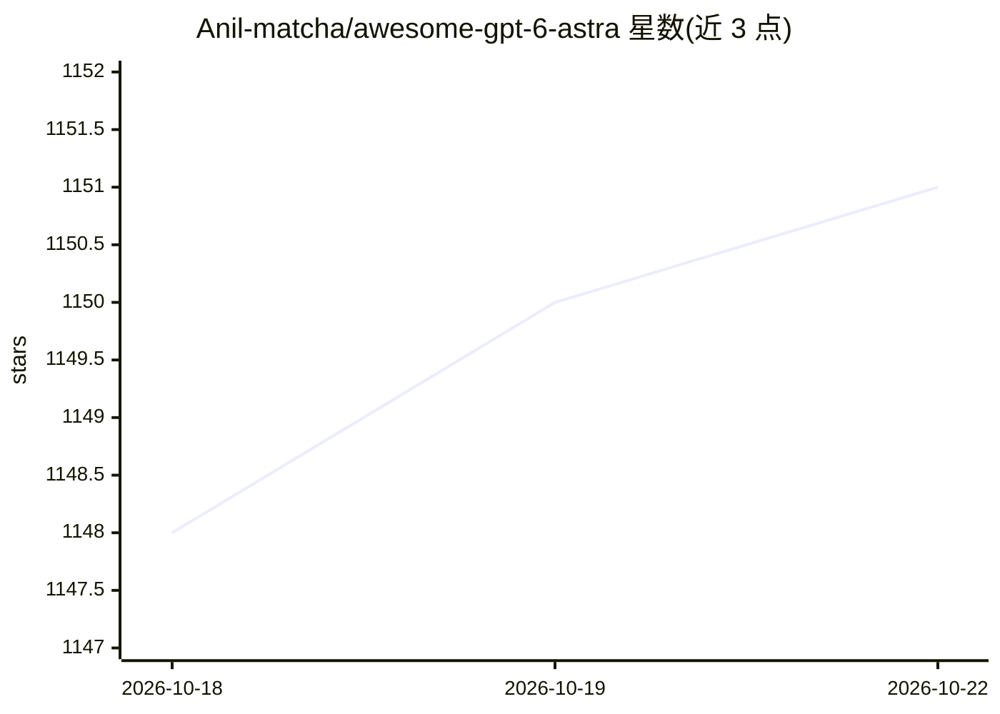

# Anil-matcha/awesome-gpt-6-astra

⭐ 1,151 · MIT · 推送 2026-10-03 · [GitHub](https://github.com/Anil-matcha/awesome-gpt-6-astra) · 个人维护

**GPT-6 Astra 用例/提示词/集成/评测与安全笔记的策展清单**

围绕 OpenAI GPT-6 Astra 模型的高信号用例清单：汇总 27 个按证据标注的用例（编码、Agent 编排、研究、计算机使用、安全防御、发布证据、社区反应）及编码 Agent 指南。每条用例附证据类型、来源与日期，条目以 OpenAI 官方模型指南、API 文档和安全材料为依据。另给出快速事实表（上下文窗口 1.05M tokens、输出 128K、价格、推理档位）、Responses API 快速接入示例，以及 MuAPI 统一 API 的替代接入途径。内容标注为 2026-09-04 快照，需复核。

## 筛选速览

| 维度 | 判定 | 备注 |
|---|---|---|
| AI 角色 | `ai-knowledge` | 知识聚合/清单类 |
| 许可风险 | `permissive` | MIT |
| 部署形态 | `None` |  |
| 模型依赖 | — | README 未给出锁定关系 |
| 硬件要求 | — | 无带数字的原话,不猜 |
| 安装摩擦 | `low` | 无编译、无系统依赖或容器化 |
| 成熟度 | — | 结构信号不足 |

## 能力要点

- 27 个用例按 7 大类组织，每条标注证据类型与来源
- 快速事实表：1.05M token 上下文、128K 最大输出、$10/$50 每百万 token
- 覆盖异步工具编排、中途转向、动态推理档位、计算机使用等模式
- 附 Responses API curl/Python 快速接入示例与 MuAPI 替代通道

## 适用场景

- 查找 GPT-6 Astra 各场景的提示词模板与工作流起点
- 了解 Astra 的模型规格、推理档位与工具能力
- 规划计算机使用与安全相关自动化时查阅注意事项

## 场景标签

`精选清单` `提示工程` · 领域:Agent 开发

## 证据(README 行号)

> L28: Welcome to the **Awesome Astra** high-signal use-case repository.
> L30: This collection tracks practical workflows, prompts, integrations, evaluations, and safety notes for **GPT-6 Astra*

## 星数曲线

2026-10-18 1,148 → 2026-10-22 1,151（+3）

---
*卡片 v1 · prompt 1.4 · 生成 2026-10-21 · 置信度 high · 依据 README sha `d7f953ad75d5` · [字段定义](../../DATASET.md)*
