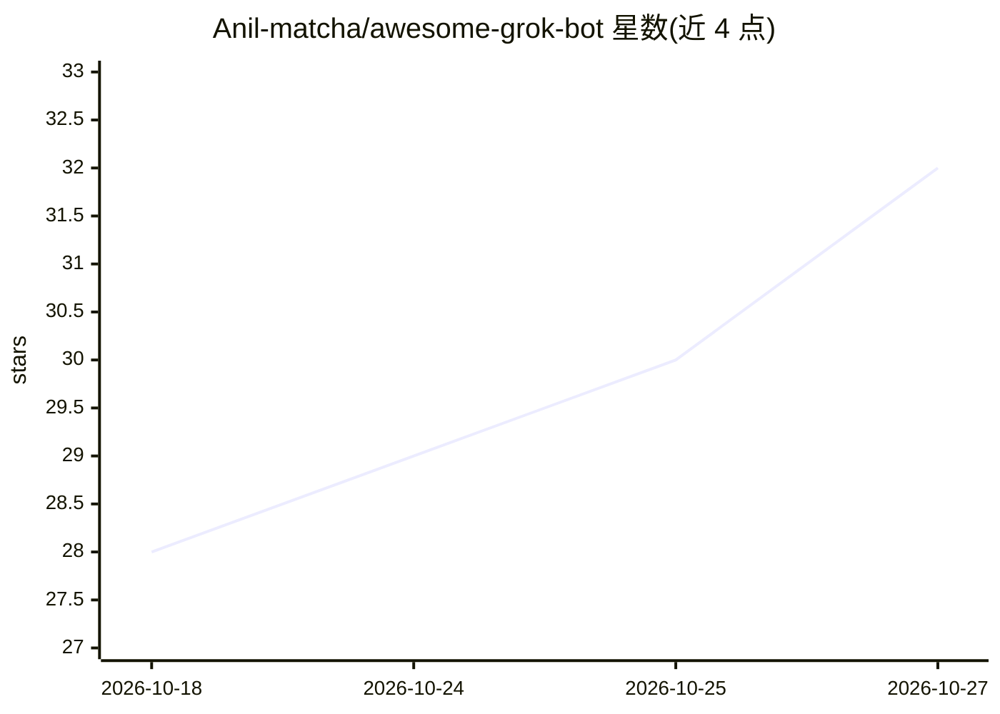

# Anil-matcha/awesome-grok-bot

⭐ 32 · 推送 2026-09-20 · [GitHub](https://github.com/Anil-matcha/awesome-grok-bot) · 个人维护

**面向 Grok 的即用型机器人提示词模板清单**

一个 awesome 风格的策展清单：收录可直接复制到 Grok 中使用的机器人模板，覆盖生产力、销售、营销、运营、客户成功与个人工作流等类别。每个条目给出完整提示词、所涉集成（如 Slack、Notion、Google Calendar、Gmail、ClickUp、Linear 等）与原作者署名；使用方式是复制提示词放入 Grok，再按自身账号与工具调整。另列出三个相关项目。清单本身不含代码或安装流程。

## 筛选速览

| 维度 | 判定 | 备注 |
|---|---|---|
| AI 角色 | `ai-knowledge` | 知识聚合/清单类 |
| 许可风险 | `none` | — |
| 部署形态 | `library` | 以包/库形式分发 |
| 模型依赖 | — | README 未给出锁定关系 |
| 硬件要求 | — | 无带数字的原话,不猜 |
| 安装摩擦 | `low` | 无编译、无系统依赖或容器化 |
| 成熟度 | — | 结构信号不足 |

## 能力要点

- 按生产力/销售/营销/运营等工作流分类组织的机器人模板
- 每条模板含完整提示词、集成项与原作者署名
- 模板普遍内置审批确认与监督首次运行的流程设计

## 适用场景

- 找一个现成提示词快速在 Grok 里搭一个工作机器人
- 了解他人如何用 Grok 机器人做日程、邮件、任务管理
- 参考模板结构改写出适配自己工具链的机器人

## 场景标签

`精选清单` `提示工程` · 领域:Agent 开发

## 证据(README 行号)

> L1: # Awesome Grok Bot
> L3: > A curated list of ready-to-use Grok bot templates — full prompts, integrations, and original creators — spanning p
> L17: **Integrations:** Grok · **Creator:** @nateherk

## 星数曲线

2026-10-18 28 → 2026-10-27 32（+4）

---
*卡片 v1 · prompt 1.4 · 生成 2026-10-26 · 置信度 mid · 依据 README sha `ae18e3ebc8c4` · [字段定义](../../DATASET.md)*
