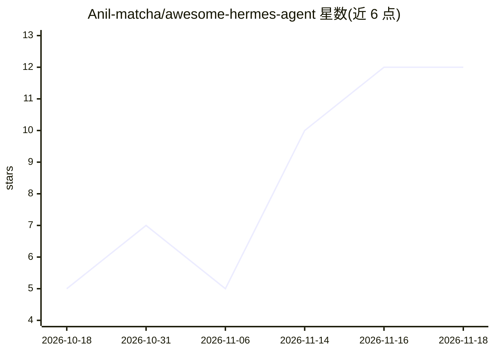

# Anil-matcha/awesome-hermes-agent

⭐ 12 · MIT · 推送 2026-10-04 · [GitHub](https://github.com/Anil-matcha/awesome-hermes-agent) · 个人维护

**Hermes Agent 的技能、插件与集成资源策展清单**

由社区维护的 awesome 类清单，收录围绕 Nous Research 的 Hermes Agent 的技能、插件、工具、集成与社区资源。条目按官方资源、社区技能、agentskills.io 生态等章节组织，每条带 production/beta/experimental 成熟度标签。README 同时概述 Hermes Agent 的核心机制（从经验生成技能、自治 Curator 周期整理技能库、18 个消息平台接入、7 种执行后端、可插拔模型提供方），并链接官方文档与相关 awesome 清单。清单本身不提供安装命令，入门路径指向官方文档。

## 筛选速览

| 维度 | 判定 | 备注 |
|---|---|---|
| AI 角色 | `ai-knowledge` | 知识聚合/清单类 |
| 许可风险 | `permissive` | MIT |
| 部署形态 | `self-host` | docker 或自建部署 |
| 模型依赖 | — | README 未给出锁定关系 |
| 硬件要求 | — | 无带数字的原话,不猜 |
| 安装摩擦 | `low` | 无编译、无系统依赖或容器化 |
| 成熟度 | — | 结构信号不足 |

## 能力要点

- 按官方/社区/agentskills.io 生态分章节收录技能与插件资源
- 每条资源带 production/beta/experimental 成熟度标签
- 概述 Hermes Agent 的 18 个消息平台与 7 种执行后端
- 提供生态快照：核心仓库版本、星数与最近审阅日期

## 适用场景

- 为 Hermes Agent 查找可安装的社区技能与插件
- 部署 Hermes 前了解其消息平台、后端与模型提供方选项
- 按成熟度标签筛选生态中的 production 级工具

## 场景标签

`精选清单` · 领域:学习与行业

## 证据(README 行号)

> L7: > A hand-picked collection of skills, plugins, tools, integrations, and community resources for Hermes Agent — the s
> L11: This list tracks the ecosystem building around it.
> L40: ## Contents

## 星数曲线

2026-10-18 5 → 2026-11-18 12（+7）

---
*卡片 v1 · prompt 1.4 · 生成 2026-11-18 · 置信度 mid · 依据 README sha `e70f2ba59825` · [字段定义](../../DATASET.md)*
